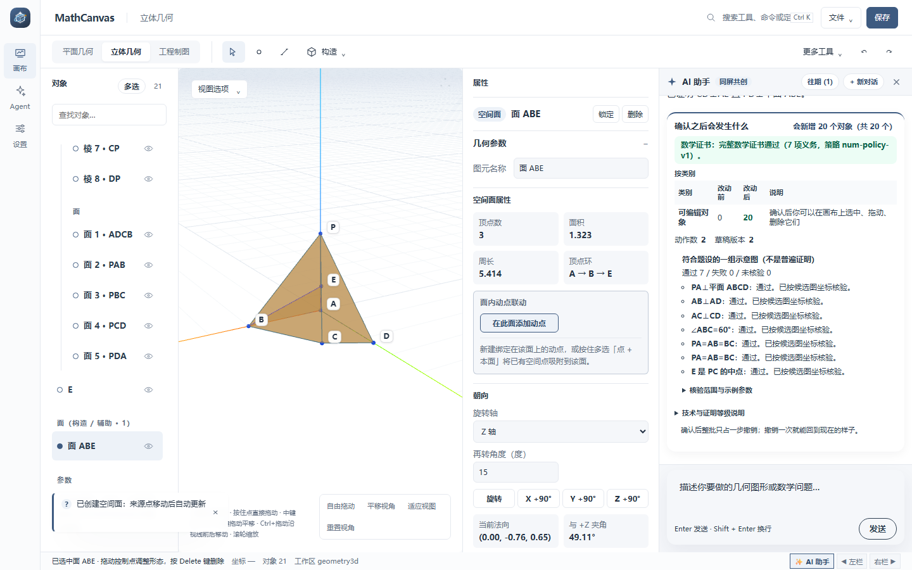
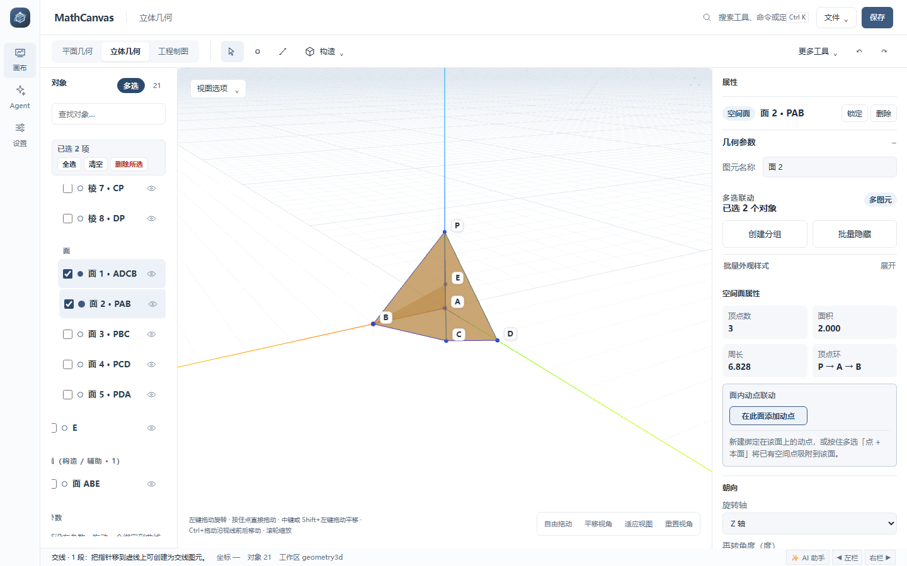
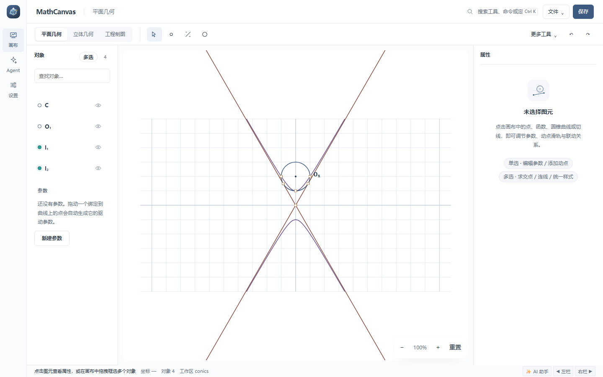
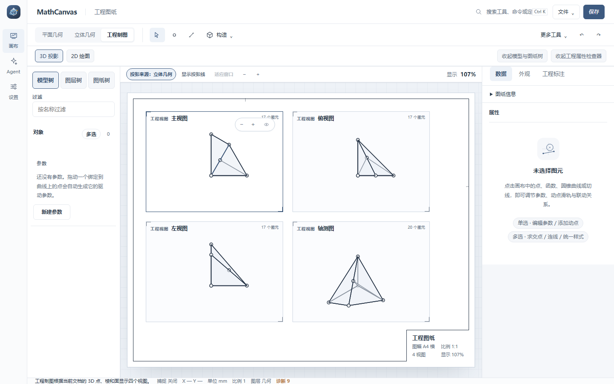
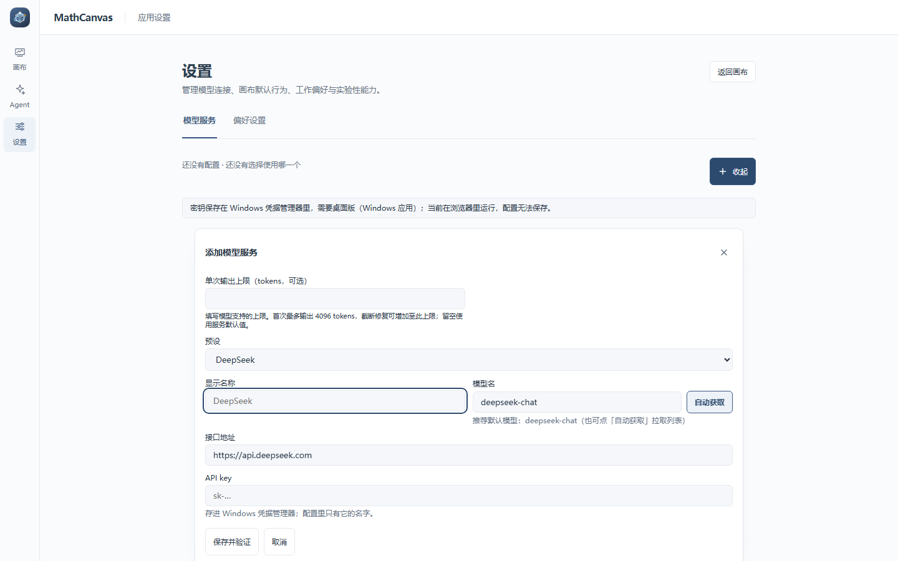

<div align="center">


# MathCanvas

**AI-Native Interactive Workbench for 2D/3D Geometry, University Higher Mathematics, Conics & CAD Projection**

[](https://github.com/Huo0077/mathcanvas/releases/tag/v6.0.0)
[](https://github.com/Huo0077/mathcanvas/actions/workflows/ci.yml)
[](https://github.com/Huo0077/mathcanvas/actions/workflows/android-release.yml)
[](https://github.com/Huo0077/mathcanvas/stargazers)


<p>
  <a href="README.md">简体中文</a>
  &nbsp;|&nbsp;
  <b>English</b>
</p>

<p>
  <a href="#-unified-downloads-v600"><b>📥 Download v6.0.0</b></a>
  &nbsp;·&nbsp;
  <a href="#-screenshots">📸 Screenshots</a>
  &nbsp;·&nbsp;
  <a href="#-why-mathcanvas">🎯 Why MathCanvas</a>
  &nbsp;·&nbsp;
  <a href="#-core-capabilities">✨ Core Capabilities</a>
  &nbsp;·&nbsp;
  <a href="#-quick-start">🚀 Quick Start</a>
  &nbsp;·&nbsp;
  <a href="https://huo0077.github.io/mathcanvas/">🌐 Official Website</a>
</p>

</div>

---

> **MathCanvas** brings **natural-language AI math problem solving**, **reactive 2D/3D dynamic geometry**, **conic sections**, **a 10-module university higher-mathematics visual lab**, and **4-view CAD engineering projection** into a single fast, native workbench for **Windows, Android, and Web**. Drag dynamic points on edges/faces/curves, inspect exact radical values (`sin` / `cos` of dihedral and line-plane angles), simulate 2D Heat/Wave/Poisson PDEs at 60fps, or paste a full exam problem and let the built-in AI Agent construct and mathematically verify the scene before committing it to the canvas.
>
> **Feedback & Bug Reports**: MathCanvas is actively developed. Found a bug or a math problem that cannot be drawn yet? Open a [GitHub Issue](https://github.com/Huo0077/mathcanvas/issues/new/choose) or email **[dogf9066@gmail.com](mailto:dogf9066@gmail.com)**.

---

## 📥 Unified Downloads (v6.0.0)

All official Windows x64 and Android ARM64 installers (with SHA-256 checksums) are available on [GitHub Releases (`v6.0.0`)](https://github.com/Huo0077/mathcanvas/releases/tag/v6.0.0):

| Platform | Package Type | Best For | Direct Download |
| --- | --- | --- | --- |
| **Windows x64** | **NSIS Installer** (Recommended) | Everyday desktop use with Start Menu shortcut & uninstaller | [MathCanvas_6.0.0_x64-setup.exe](https://github.com/Huo0077/mathcanvas/releases/download/v6.0.0/MathCanvas_6.0.0_x64-setup.exe) |
| **Windows x64** | **Portable Executable** | Zero-install USB / classroom PCs without admin rights | [MathCanvas_6.0.0_x64.exe](https://github.com/Huo0077/mathcanvas/releases/download/v6.0.0/MathCanvas_6.0.0_x64.exe) |
| **Windows x64** | **MSI Package** | School lab / enterprise silent deployment | [MathCanvas_6.0.0_x64_en-US.msi](https://github.com/Huo0077/mathcanvas/releases/download/v6.0.0/MathCanvas_6.0.0_x64_en-US.msi) |
| **Android ARM64** | **Signed Release APK** (Recommended) | Android 7.0+ phones & tablets with Material 3 touch UI | [MathCanvas-6.0.0-android-arm64.apk](https://github.com/Huo0077/mathcanvas/releases/download/v6.0.0/MathCanvas-6.0.0-android-arm64.apk) |

- **Checksums**: [SHA256SUMS-windows.txt](https://github.com/Huo0077/mathcanvas/releases/download/v6.0.0/SHA256SUMS-windows.txt) · [SHA256SUMS-android.txt](https://github.com/Huo0077/mathcanvas/releases/download/v6.0.0/SHA256SUMS-android.txt) · [All Releases](https://github.com/Huo0077/mathcanvas/releases)

---

## 📸 Screenshots

### AI Co-Pilot + Reactive 3D Solid Geometry & Certificate Gate



### Specialized Workspaces & Multi-Provider Model Hub

| 3D Dihedral Angle & View Sync | 2D Conic Sections & Asymptotes |
| :---: | :---: |
|  |  |

| 4-View CAD Orthographic Projection | 13 Built-In LLM Provider Presets |
| :---: | :---: |
|  |  |

---

## 🎯 Why MathCanvas?

| Capability | **MathCanvas v6.0** | GeoGebra | Desmos | MATLAB / Python |
| --- | :---: | :---: | :---: | :---: |
| **Natural-Language Problem → Verified Scene** | ✅ Built-in AI + Certificate Gate | ❌ Manual commands | ❌ Formulas only | ❌ Requires coding |
| **3D Solid Folding, Auxiliary Planes & Exact Angles** | ✅ Exact radical `sin` / `cos` | ⚠️ Numerical mostly | ❌ Limited 3D | ❌ Scripted plots |
| **Zero-Code University Higher-Math & 60fps PDE Lab** | ✅ 10 interactive visual modules | ⚠️ Partial | ❌ 1D/2D focus | ⚠️ Paid / coding |
| **3D → Standard 4-View CAD Engineering Export** | ✅ SVG / DXF / PDF / HTML | ❌ | ❌ | ❌ |
| **Lightweight Native Desktop + Android Offline App** | ✅ Tauri 2 (~10 MB) + Signed APK | ✅ | 🌐 Web/Mobile | ❌ Multi-GB desktop |

---

## ✨ Core Capabilities

1. **AI Problem Reader & Mathematical Verification Certificate Gate**:
   - Paste high-school geometry, conic section, or university calculus/linear-algebra/probability problems directly in natural language.
   - Automatically infers auxiliary segments and spatial planes, previews every candidate primitive in an isolated ghost draft, verifies premises numerically/symbolically before commit, and supports single-step `Ctrl+Z` undo.
2. **Five Specialized Workspaces**:
   - **Planar Geometry & Conics**: Points, lines, circles, arcs, ellipses, hyperbolas (with automatic asymptotes), parabolas, derivatives, tangents, definite integrals, and curve-bound dynamic points.
   - **3D Solid Geometry**: Polyhedra wizard, point-on-edge/face/solid bindings, unfolded net animation, circumscribed/inscribed spheres, and one-click dihedral, line-plane, and skew-line angle measurements with exact radical expressions.
   - **University Higher Mathematics (10 Interactive Modules)**:
     1. 1D Extrema, Inflection Points, Asymptotes & 24×12 Gauss–Legendre Definite Integrals
     2. 2D Lagrange Multipliers (`∇f = λ∇g` contour tangency + 2D↔3D surface lift)
     3. Explicit 3D Surfaces `z = f(x, y)` (Hessian classification, saddle points, tangent planes & level slices)
     4. 1D ODE Slope Fields (Dormand–Prince RK45 IVP solver)
     5. 2D Autonomous Phase Planes & Vector Fields (Jacobian eigenvalues, stability, divergence & curl probe)
     6. 60fps WebWorker 2D PDE Simulator (Heat, Wave & Poisson equations with Dirichlet/Neumann boundaries)
     7. Jet Automatic Differentiation Taylor Polynomials & Fourier Epicycle Synthesis
     8. Cartesian (`dx dy` / `dy dx`) & Polar (`r dr dθ`) Double Integrals with 3D Riemann Prisms
     9. `2×2` Linear Algebra Transformations (Homotopy animation, complex/real eigenvalues & SVD unit-circle deformation)
     10. Probability Distributions (Normal, Binomial, Poisson, Exponential, `χ²`, Student-`t`) & Central Limit Theorem Lab
   - **Engineering Drafting (CAD)**: One-click front, top, left, and axonometric projections from 3D models, layers, dimensions, and SVG / DXF / PDF / standalone interactive HTML exports.
   - **13 LLM Provider Presets & Native Encrypted Keyring**: DeepSeek, OpenAI, Claude, Gemini, Qwen, GLM, Kimi, SiliconFlow, Doubao, OpenRouter, Ollama, LM Studio, and custom OpenAI-compatible endpoints, backed by Windows Credential Manager and Android `ChaCha20 + HMAC-SHA256` encrypted storage.

---

## 🚀 Quick Start

```bash
# Install dependencies (Node.js 22+ recommended)
npm install

# Start the local Web workbench at http://localhost:5173
npm run dev

# Or launch the Tauri 2 native desktop app (requires Rust 1.77.2+)
npm run dev --workspace @draw/desktop
```

Quality & verification commands:

```bash
npm run typecheck   # Workspace-wide TypeScript check
npm run lint        # ESLint static analysis
npm test            # Vitest unit & kernel solver suite
npm run test:docs   # Documentation & version consistency gate
npm run test:e2e    # Playwright Chromium end-to-end suite
npm run test:rust   # Rust host unit tests
```

---

## ⭐ Star History & Citation

If MathCanvas helps your learning, teaching, or research, please consider giving the repository a **Star ★** on GitHub! Academic users can click **"Cite this repository"** on the GitHub sidebar (powered by [`CITATION.cff`](CITATION.cff)).

[](https://star-history.com/#Huo0077/mathcanvas&Date)
