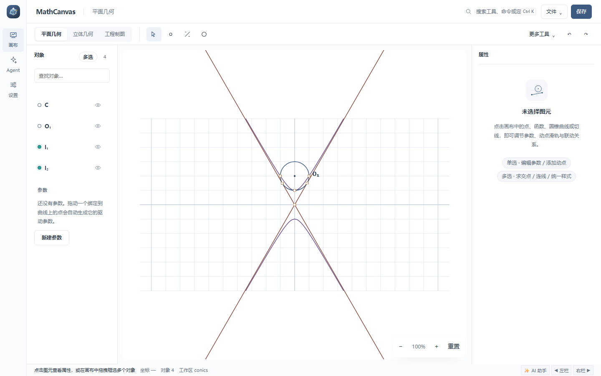
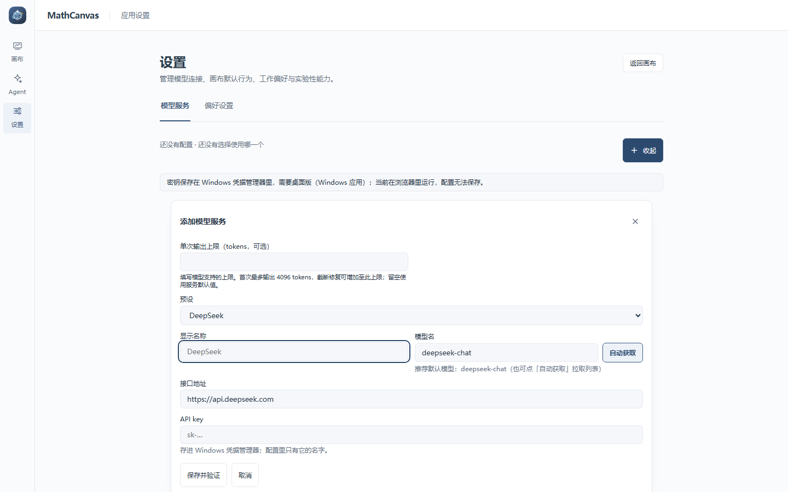
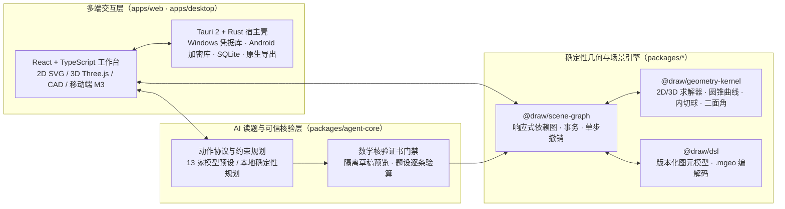

<div align="center">


# MathCanvas

**面向中学数学教学、立体几何探究与工程绘图的 AI 原生交互式数学工作台**

[](https://github.com/Huo0077/mathcanvas/releases/tag/v5.2.0)
[](https://github.com/Huo0077/mathcanvas/actions/workflows/ci.yml)
[](https://github.com/Huo0077/mathcanvas/actions/workflows/android-release.yml)
[](https://github.com/Huo0077/mathcanvas/stargazers)


<p>
  <a href="#-全平台整合下载v520"><b>📥 下载整合版 v5.2.0</b></a>
  &nbsp;·&nbsp;
  <a href="#-界面展示">📸 界面展示</a>
  &nbsp;·&nbsp;
  <a href="#-核心特性">✨ 核心特性</a>
  &nbsp;·&nbsp;
  <a href="#-系统架构">🏗️ 系统架构</a>
  &nbsp;·&nbsp;
  <a href="#-快速开始">🚀 快速开始</a>
  &nbsp;·&nbsp;
  <a href="https://huo0077.github.io/mathcanvas/">🌐 在线官网</a>
  &nbsp;·&nbsp;
  <a href="CONTRIBUTING.md">🤝 参与贡献</a>
</p>

</div>

---

> **MathCanvas** 将 **自然语言 AI 读题作图**、**动态几何约束联动**、**二维解析 / 函数分析**、**三维立体空间建模** 与 **工程制图四视图投影** 整合在同一个流畅的跨端工作台中。你可以像在传统几何软件里那样自由拖拽动点、调节参数、测量距离与二面角，也可以直接输入一道完整的数学题，由内置 AI 助手自动理解题意、构造图形、联动辅助线与空间面，并经独立数学核验证书检验后写入画布继续探索。
>
> **持续更新与问题反馈**：MathCanvas 持续高频迭代中。如遇软件 Bug 或有题目无法画出，欢迎直接提交 [GitHub Issue](https://github.com/Huo0077/mathcanvas/issues/new/choose) 或发邮件至 **[dogf9066@gmail.com](mailto:dogf9066@gmail.com)**。

---

## 📥 全平台整合下载（v5.2.0）

**`v5.2.0`** 为 **Windows x64 + Android ARM64 全平台整合正式版**，所有安装包与 SHA-256 校验文件统一托管于 [GitHub Releases](https://github.com/Huo0077/mathcanvas/releases/tag/v5.2.0)：

| 平台 | 安装包类型 | 适用场景 | 直链下载 |
| --- | --- | --- | --- |
| **Windows x64** | **NSIS 标准安装程序**（推荐） | 日常使用，含开始菜单快捷方式与标准卸载 | [MathCanvas_5.2.0_x64-setup.exe](https://github.com/Huo0077/mathcanvas/releases/download/v5.2.0/MathCanvas_5.2.0_x64-setup.exe) |
| **Windows x64** | **绿色免安装便携版** | U 盘随身携带、机房免管理员权限即点即用 | [MathCanvas_5.2.0_x64.exe](https://github.com/Huo0077/mathcanvas/releases/download/v5.2.0/MathCanvas_5.2.0_x64.exe) |
| **Windows x64** | **MSI 安装包** | 学校机房域控批量分发 / 静默部署 | [MathCanvas_5.2.0_x64_en-US.msi](https://github.com/Huo0077/mathcanvas/releases/download/v5.2.0/MathCanvas_5.2.0_x64_en-US.msi) |
| **Android ARM64** | **正式签名 APK**（推荐） | Android 7.0+ 手机 / 平板，Material 3 触控重排 | [MathCanvas-5.2.0-android-arm64.apk](https://github.com/Huo0077/mathcanvas/releases/download/v5.2.0/MathCanvas-5.2.0-android-arm64.apk) |

- **校验文件**：[SHA256SUMS-windows.txt](https://github.com/Huo0077/mathcanvas/releases/download/v5.2.0/SHA256SUMS-windows.txt) · [SHA256SUMS-android.txt](https://github.com/Huo0077/mathcanvas/releases/download/v5.2.0/SHA256SUMS-android.txt) · [查看全部历史 Releases](https://github.com/Huo0077/mathcanvas/releases)
- **软件官网门户**：仓库根目录自带纯静态展示门户 [`portal/`](portal/index.html)（含使用说明、实机操作演示视频 `portal/assets/media/demo-workflow.webm`、多工作区交互画廊及 GitHub Releases 直链下载，可直接部署至任意静态 Web 服务器）。

---

## 📸 界面展示

### AI 同屏共创 · 立体几何与构造面自动联动


### 四大专业工作区与模型设置中心

| 立体几何多选与视图联动 | 平面圆锥曲线与渐近线求解 |
| :---: | :---: |
|  |  |

| 工程制图（CAD 四视图自动投影） | 13 家模型预设与模型列表一键拉取 |
| :---: | :---: |
|  |  |

---

## ✨ 核心特性

### 1. 智能 AI 读题构图与数学核验证书门禁
- **自然题干直接理解**：输入常见中学或竞赛纯文字数学题（支持单问与多小问递进题），无需手写构图指令。（*说明：识图能力将在后续版本正式接入，当前已通过 `IMAGE_READER_UI_ENABLED = false` 隐藏前端识图 UI 入口。*）
- **主动补线与「以线推面」**：自动提取并补全题设线段与动点约束（中点、定比分点、动点连线 `AE`、`CE`），自动推导构造空间面（如 `面 AEC`），并完整保留实体面内的构造子面（如底面 `ABCD` 内的 `△AEF`）。
- **预览态与提交后图元框全量可见**：Agent 完成作图后，图元框立即以独立「AI 预览图元」分组展示全部待落盘对象并支持点击检视属性；确认写入后多面体与命名折叠面默认展开，直接列出全部**顶点 / 棱 / 面**，且支持 `Ctrl+Z` 一步完整撤销。
- **跨工作区自动路由与往期回溯**：平面解析几何、圆锥曲线切线、函数导数题与立体几何题自动路由到对应维度画布；「往期」面板随时回溯完整推理与上下文。

### 2. 四大专业工作区
- **平面几何（含函数与圆锥曲线）**：点、线、圆、圆弧、椭圆/双曲线/抛物线方程直出、渐近线与切圆自动推导、函数求导/切线/定积分区域，以及曲线轨道动点实时联动与全图元自动取景。
- **立体几何（3D 实时交互）**：常用立体向导、点绑棱/面/实体、两线定面、单顶点拖拽与多面体自动三角化、透明面/隐藏边/法向量/旋转环/展开图双向联动，以及二面角 `sin` / `cos` 精确值一键复制。
- **工程制图（CAD）**：由 3D 文档一键自动投影生成标准四视图（主视/俯视/左视/轴测），支持图层管理、2D 工程标注及 SVG / DXF / PDF / 自包含 HTML 交互快照导出。
- **Agent 与多模型服务设置**：内置 **13 家主流模型预设**（DeepSeek、OpenAI、Claude、Gemini、通义千问、智谱 GLM、Kimi、硅基流动、豆包、OpenRouter、Ollama、LM Studio 及自定义 OpenAI 兼容接口），支持一键「自动获取」可用模型列表与丰富的偏好设置。

### 3. Android 移动端深度重构与原生集成
- **Material Design 3 画布优先布局**：窄屏自动切换底部导航栏（释放 100% 屏宽）、精简双行顶栏与单行横向滑动工具条、画布毛玻璃悬浮胶囊、圆角 Bottom Sheet 抽屉与 Android 系统返回键逐级回退。
- **全手势与原生导出分享**：2D 单指平移 / 双指捏合缩放、3D 单指旋转 / 双指缩放平移；通过受控 `@JavascriptInterface` 与 Android 10+ `MediaStore.Downloads` 零权限直出公共 `下载/MathCanvas/` 目录并唤起系统分享面板。
- **跨端本地加密存密**：Windows 使用系统凭据管理器，Android 使用应用私有 `ChaCha20 + HMAC-SHA256` 加密凭据库（禁用 `allowBackup`），API Key 绝不落明文文件。

---

## 🏗️ 系统架构



### 仓库目录结构

| 目录 | 职责说明 |
| --- | --- |
| `apps/web` | React + TypeScript 前端工作台（SVG 2D 画布、Three.js 3D 场景、对象树与属性栏、Agent 抽屉、设置中心、移动端 Material 3 适配） |
| `apps/desktop` | Tauri 2 + Rust 原生宿主壳（Windows / Android 加密凭据库、模型列表拉取、SQLite 文档持久化、原生文件导出与系统分享） |
| `packages/dsl` | 版本化几何文档模型、图元 Schema 校验与 `.mgeo` 编解码 |
| `packages/geometry-kernel` | 2D/3D 数值与解析几何求解器、圆锥曲线/导数求导、三点/多点共面、最大内切球与二面角测量引擎 |
| `packages/scene-graph` | 响应式依赖图、宿主/面片拓扑复用、文档事务与撤销/重做栈 |
| `packages/agent-core` | Agent 动作契约、约束/义务验证与数学核验证书门禁 |
| `portal` | 纯静态软件官网门户（支持直接部署至任意静态 Web 服务器） |
| `e2e` & `scripts` | Playwright 全链路 E2E 测试、Android 打包加固脚本与文档一致性门禁 |

---

## 🚀 快速开始

### 方式一：本地 Web 工作台开发

需安装 Node.js（推荐 `v22+`）与 npm：

```bash
# 1. 安装依赖
npm install

# 2. 启动工作台（默认访问 http://localhost:5173）
npm run dev
```

> Windows PowerShell 若策略限制直接调用 `npm`，请使用 `npm.cmd install` 与 `npm.cmd run dev`。

### 方式二：构建多端原生应用（Windows / Android / Linux，Tauri 2）

需安装 Rust `1.77.2+` 工具链（桌面壳细节见 [桌面端说明](apps/desktop/README.md)）：

```bash
# 启动桌面端开发调试
npm run dev --workspace @draw/desktop

# 构建 Windows 安装包（NSIS + MSI + 便携版）
npm run bundle --workspace @draw/desktop

# 构建并签名 Android ARM64 APK（需 JDK 17/21、Android SDK/NDK 27+ 与 aarch64-linux-android target）
npm run android:init --workspace @draw/desktop
npm run android:build:local --workspace @draw/desktop
```

<details>
<summary><b>⌨️ 点击展开：日常快捷键与画布手势速查</b></summary>

| 功能 | 操作方式 |
| --- | --- |
| 选择与联动编辑 | 单击图元选中，直接拖动点或控制点；`Shift` 点击多选 |
| 绑定动点到线 / 面 / 立体 | 多选「点 + 目标宿主」后在右侧属性栏一键绑定；或选中面/棱点 **「在此面添加动点」** |
| 两线定面 | 在立体几何中多选两条共端点相交线段/棱，右侧属性栏点击 **「作空间面」** |
| 移动与缩放画布 | 中键拖动（2D 下 `Space`+左键拖动）；滚轮缩放；3D 下左键拖空白旋转、右键平移；触屏支持 2D/3D 双指捏合缩放与平移 |
| 测量二面角与角度三角值 | 选中两个面（或按 `Alt` 选中实体表面），点击 **「测量二面角」**，即可查看角度、`sin`/`cos` 与精确复制 |
| 快速搜索命令 / 撤销重做 | `Ctrl+K` 调起命令搜索；`Ctrl+Z` / `Ctrl+Y` / `Esc` |
| 保存、打开与多格式导出 | 顶部菜单「文件」支持 `.mgeo` 项目文档、SVG / DXF / PDF / PNG / CSV 与自包含 HTML 交互快照 |

</details>

---

## 🧪 研发与质量门禁

```bash
npm run typecheck   # 全仓 TypeScript 类型检查
npm run test:docs   # 文档、链接与版本真值一致性门禁
npm run lint        # ESLint 静态检查
npm run build       # 构建所有工作区包
npm test            # 全量单元测试
npm run test:e2e    # Playwright 浏览器端到端测试
npm run test:rust   # Rust 原生宿主单元测试
```

CI / 发布流水线：
- [`.github/workflows/ci.yml`](.github/workflows/ci.yml)：常规 PR / 主分支构建、类型检查、Rust 测试与 E2E 门禁
- [`.github/workflows/multiplatform-build.yml`](.github/workflows/multiplatform-build.yml)：多平台构建验证
- [`.github/workflows/android-release.yml`](.github/workflows/android-release.yml)：`v*` 版本标签自动并行构建 **Windows x64 三件套 + Android ARM64 签名 APK** 并整合发布至 GitHub Releases

---

## 🤝 参与贡献与安全政策

- 欢迎阅读 [贡献指南（CONTRIBUTING.md）](CONTRIBUTING.md) 参与开发、提交 PR 或通过 [Issue 模板](https://github.com/Huo0077/mathcanvas/issues/new/choose) 反馈难以画出的数学题。
- 安全设计与漏洞报告流程请见 [安全政策（SECURITY.md）](SECURITY.md)。

---

## 📚 文档与版本导航

- **最新发布说明与版本信息**：最新版本标签为 **`v5.2.0`**（[发布说明](docs/release/v5.2.0.md)），完整变更记录见 [CHANGELOG](CHANGELOG.md)。
- **工程进度与技术文档**：
  - [当前状态（唯一实时状态入口）](docs/current-status.md)
  - [功能目录](docs/feature-catalog.md)
  - [项目进度日志](docs/project-progress.md)
  - [下一轮工作导航](docs/agent-next-round-progress.md)
  - [Agent 发布前门禁](docs/acceptance/agent-release-gate.md)
  - [系统架构说明](docs/architecture.md)
