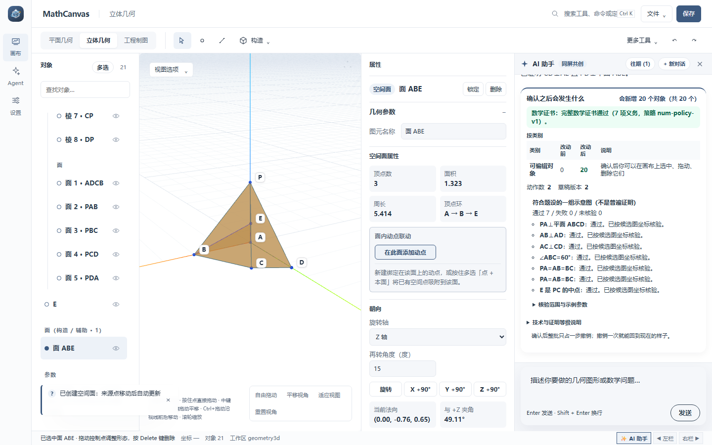
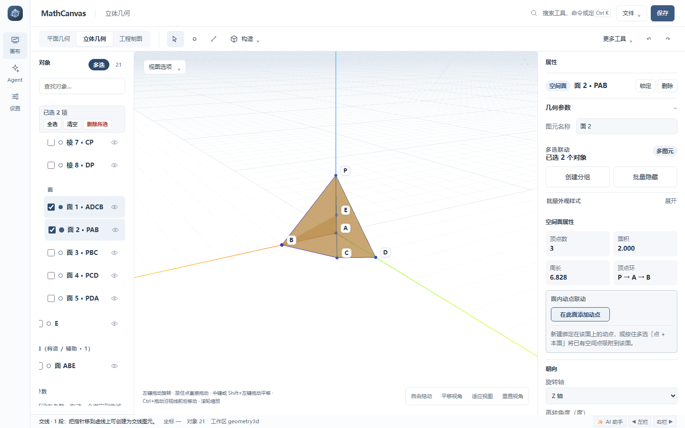
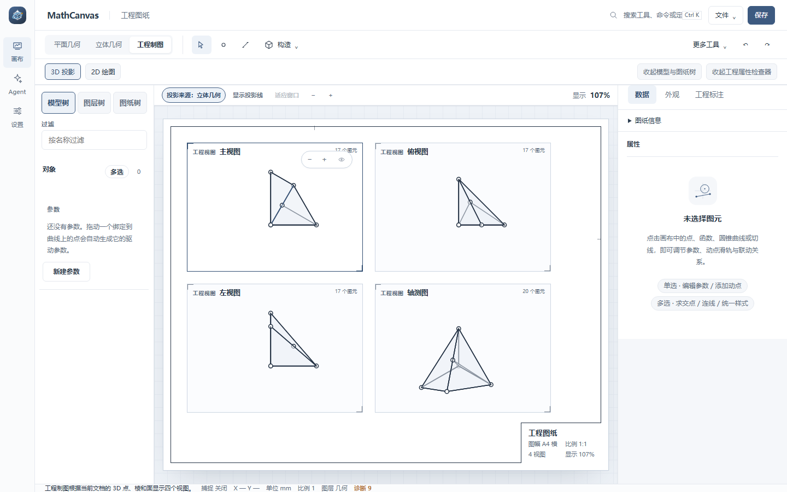

# MathCanvas

**面向中学数学教学、立体几何探究与工程绘图的 AI 原生交互式数学工作台**

MathCanvas 将**自然语言读题作图**、**动态几何约束联动**、**二维解析/函数分析**、**三维立体空间建模**与**工程制图投影**整合在同一个简洁流畅的桌面与浏览器工作台中。你可以像在传统几何软件里那样自由拖拽控制点、调节参数、测量距离与二面角，也可以直接输入一道完整的数学题，由内置 AI 助手为你自动理解题意、构造图形、联动辅助线与空间面，并在预览确认后写入画布继续探索。

- **Android 安装包下载（v5.1.0，ARM64 正式签名 APK）**：[MathCanvas-5.1.0-android-arm64.apk](https://github.com/Huo0077/mathcanvas/releases/download/v5.1.0/MathCanvas-5.1.0-android-arm64.apk) · [SHA256 校验文件](https://github.com/Huo0077/mathcanvas/releases/download/v5.1.0/SHA256SUMS-android.txt)
- **Windows 桌面端安装包下载（v5.0.0，托管于 GitHub Releases）**：[NSIS 安装程序 (.exe)](https://github.com/Huo0077/mathcanvas/releases/download/v5.0.0/MathCanvas_5.0.0_x64-setup.exe) · [绿色免安装版 (.exe)](https://github.com/Huo0077/mathcanvas/releases/download/v5.0.0/MathCanvas_5.0.0_x64.exe) · [MSI 安装包](https://github.com/Huo0077/mathcanvas/releases/download/v5.0.0/MathCanvas_5.0.0_x64_en-US.msi) · [全部 Releases](https://github.com/Huo0077/mathcanvas/releases)
- **软件官网门户**：仓库根目录自带纯静态展示门户 [`portal/`](portal/index.html)（含使用说明、实机操作演示视频 `portal/assets/media/demo-workflow.webm`、多工作区交互画廊及 GitHub Releases 直链下载，可直接部署至任意静态 Web 服务器）。
- **持续更新与问题反馈**：MathCanvas 目前仍在持续更新升级中。使用过程中如遇到 Bug 或有题目无法正确画出，请附上原题文本或截图联系 **[dogf9066@gmail.com](mailto:dogf9066@gmail.com)**。

---

## 软件界面展示

### AI 同屏共创 · 立体几何与构造面自动联动


### 四大专业工作区与设置中心

| 立体几何多选与视图联动 | 平面圆锥曲线与渐近线求解 |
| :---: | :---: |
|  |  |

| 工程制图（CAD 四视图自动投影） | 13 家模型预设与模型列表一键拉取 |
| :---: | :---: |
|  |  |

---

## 核心特色

### 1. 智能 AI 读题构图，输入正常题目即可出图
- **自然题干直接理解**：只需输入常见高中或竞赛纯文字数学题目（支持单问与多小问递进题），无需手写特殊构图命令，也无需刻意注明「作出某平面」。（*说明：识图能力将在后续版本正式接入，当前版本已通过特性开关 `IMAGE_READER_UI_ENABLED = false` 暂时隐藏前端识图 UI 入口。*）
- **主动补线与「以线推面」**：Agent 会自动提取并补全题中给出的线段与动点约束（如棱上定比分点、中点、动点连线 `AE`、`CE`），并直接由相交辅助线与动点自动推测生成对应空间面（如 `面 AEC`），第一时间显示在左侧对象栏的 **「面（构造 / 辅助）」** 分组与三维画布中。
- **同屏共创、隔离预览与一键确认**：AI 构图与计算思考过程分步折叠展示，先在隔离草稿画布预览全部图元与题设核验结果；左侧对象栏同步亮出「预览」清单供核查，点击 **「确认写入」** 原子落盘（支持 `Ctrl+Z` 一步完整撤销）。
- **往期对话完整回溯**：右上角 **「往期」** 支持随时翻阅并恢复之前的完整问答、推理轨迹与构图上下文，互不串扰。
- **跨工作区自动路由**：平面解析几何、圆锥曲线切线、函数导数题与立体几何题自动路由到对应维度画布，避免二维题目误入三维工作区。

### 2. 四大专业工作区，满足从初高中数学到工程制图
- **平面几何（含函数与圆锥曲线）**
  - 创建点、直线、线段、射线、折线、圆与圆弧，以及椭圆、双曲线、抛物线标准/一般方程图像；
  - 函数编辑器支持代数表达式绘图，一键生成 **导函数图像**、任意位置/外点/公切线 **切线** 及定积分区域；
  - 支持线/曲线/圆轨道上的 **动点绑定**，拖动动点时过点切线、弦长、交点与关联轨迹实时随动。
- **立体几何（3D 实时交互）**
  - 内置「常用立体」向导与空间点、线、面、圆轨道手工构图工具，支持单顶点调整与多面体自动三角化；
  - 支持 **点绑棱 / 点绑面 / 点绑实体**、**多选点一键连线与建面**、以及 **两条相交线段「两线定面」**；
  - 拖动棱上或面内动点时，所有关联线段与构造平面（如 `面 AEC`）实时重算面积、周长与法向；
  - 画布左上角 **「视图选项」** 与右侧属性栏双向联动（透明面、隐藏边、X/Y/Z 旋转环、法向量、自动取景、展开等）；
  - 二面角、线线角与距离测量结果统一归入右侧属性栏，自动换算角度并附带 **`sin` / `cos` 数值与精确形式一键复制**。
- **工程制图（CAD）**
  - 支持由 3D 几何文档自动投影生成四视图，以及图层管理、CAD 2D 绘图与工程尺寸标注，并支持 SVG / DXF / PDF 等格式导出。
- **Agent 与多模型服务设置**
  - 内置 **13 种主流模型预设**（DeepSeek、OpenAI、Anthropic Claude、Google Gemini 兼容接口、通义千问 Qwen、智谱清言 GLM、Moonshot Kimi、硅基流动、火山方舟 Doubao、OpenRouter、本机 Ollama / LM Studio 及自定义 OpenAI 兼容接口）；
  - 支持 **一键「自动获取」可用模型列表**，API 密钥通过 Windows 凭据管理器加密存储于本机；
  - 丰富的 **偏好设置**（界面字号与阅读密度、减少动态效果、选中/测量自动展开属性栏、3D 默认视角行为、新题绘图自动清空旧图元及实验性功能管理）。

---

## 快速开始

### 方式一：本地开发 / 浏览器工作台运行

确保本机已安装 Node.js（推荐 v22+）与 npm：

```bash
# 1. 安装依赖
npm install

# 2. 启动工作台（默认访问 http://localhost:5173）
npm run dev
```

> Windows PowerShell 下若策略限制直接调用 `npm`，请使用 `npm.cmd install` 与 `npm.cmd run dev`。

### 方式二：运行或构建多端原生应用（Windows / Linux / Android，Tauri 2）

原生应用与浏览器端共用同一套 `apps/web` 前端交互引擎，并额外提供 **原生安全凭据存密**（Windows 凭据管理器 / Linux Secret Service 优先并自动回退应用私有 `ChaCha20 + HMAC-SHA256` 加密凭据库 / Android 应用私有加密凭据库）、**本地 SQLite 文档持久化** 与 **模型列表一键自动获取** 体验（需 Rust 1.77.2+ 工具链）：

```bash
# 启动桌面端开发调试（Windows / Linux）
npm run dev --workspace @draw/desktop

# 构建 Windows 安装包 / Linux（.deb / .AppImage）安装包
npx tauri build
npm run linux:bundle --workspace @draw/desktop   # 在 Linux 上直接输出 .deb 与 .AppImage

# 构建 Android ARM64 APK（需 JDK 17/21、Android SDK/NDK 27+ 及 aarch64-linux-android Rust target）
npm run android:init --workspace @draw/desktop
npm run android:build --workspace @draw/desktop        # Linux / macOS / 启用开发者模式的 Windows
npm run android:build:local --workspace @draw/desktop  # 跨平台一键构建并签名 ARM64 APK（Windows 无需开发者模式）
```

触控端（Android 手机 / 平板）支持 **2D 平面画布单指平移与双指捏合缩放、3D 立体空间单指旋转与双指捏合缩放/平移**、Edge-to-Edge 状态栏/挖孔/导航条与软键盘安全避让、Android 系统返回键逐级回退、Agent 移动端抽屉式会话切换、`44×44` 粗指针触控热区，以及 Android Web Share / 应用受控目录原生文件导出。更多宿主壳技术细节见 [桌面端说明](apps/desktop/README.md)。

---

## 日常操作速查

| 功能 | 操作方式 |
| --- | --- |
| 选择与联动编辑 | 单击图元选中，直接拖动点或控制点；`Shift` 点击多选 |
| 绑定动点到线 / 面 / 立体 | 左侧或画布多选「点 + 目标宿主」后在右侧属性栏一键绑定；也可选中面/棱后点 **「在此面添加动点」** |
| 两线定面 | 在立体几何中多选两条共端点相交线段/棱，右侧属性栏点击 **「作空间面」** |
| 移动与缩放画布 | 中键拖动（或 2D 下 `Space`+左键拖动）；滚轮缩放；3D 下左键拖空白旋转、右键平移；触屏支持 2D/3D 双指捏合缩放与同步拖动 |
| 测量二面角与角度三角值 | 选中两个面（或按 `Alt` 选中实体表面），在右侧属性栏点击 **「测量二面角」**，即可查看角度、`sin`/`cos` 与精确复制按钮 |
| 快速搜索工具与命令 | 按 `Ctrl+K` 调起命令与工具搜索 |
| 撤销 / 重做 / 取消当前操作 | `Ctrl+Z` / `Ctrl+Y` / `Esc` |
| 保存、打开与导出 | 顶部菜单「文件」支持保存/打开 `.mgeo` 项目文档、导出 SVG / DXF / PDF / PNG / CSV 及 **自包含 HTML 交互快照**（支持拖回原样打开） |

---

## 项目结构

MathCanvas 采用 npm workspaces 单仓多包架构：

| 目录 | 职责说明 |
| --- | --- |
| `apps/web` | React + TypeScript 前端工作台（SVG 2D 画布、Three.js 3D 场景、对象树与属性栏、Agent 对话抽屉、设置面板） |
| `apps/desktop` | Tauri 2 + Rust 桌面宿主壳（原生凭据库、模型接口与可用模型获取、SQLite 文档持久化、桌面图标与无黑框启动） |
| `packages/dsl` | 版本化几何文档模型、图元 Schema 校验与 `.mgeo` 编解码 |
| `packages/geometry-kernel` | 2D/3D 数值与解析几何求解器、圆锥曲线/导数求导、三点/多点共面、最大内切球与二面角测量引擎 |
| `packages/scene-graph` | 响应式依赖图、宿主/面片拓扑复用、文档事务与撤销/重做栈 |
| `packages/agent-core` | Agent 动作契约、约束/义务验证与数学核验证书门禁 |

---

## 研发与质量验证

```bash
npm run typecheck   # 全仓 TypeScript 类型检查
npm run test:docs   # 文档与版本一致性门禁检查
npm run build       # 构建所有工作区包
npm run lint        # ESLint 静态检查
npm test            # 全量单元测试
npm run test:e2e    # Playwright 浏览器端到端测试
npm run test:rust   # 桌面端 Rust 单元测试
```

自动化流水线配置见 [`.github/workflows/ci.yml`](.github/workflows/ci.yml)、多平台构建工作流 [`.github/workflows/multiplatform-build.yml`](.github/workflows/multiplatform-build.yml) 与 Android 正式发布工作流 [`.github/workflows/android-release.yml`](.github/workflows/android-release.yml)（打 `v*` 标签自动签名、校验并推送 GitHub Release）。

---

## 文档与版本导航

- **最新发布说明与版本信息**：最新版本标签为 **`v5.1.0`**（[发布说明](docs/release/v5.1.0.md)），完整变更记录见 [CHANGELOG](CHANGELOG.md)。
- **工程进度与技术文档**：
  - [当前状态（唯一实时状态入口）](docs/current-status.md)
  - [功能目录](docs/feature-catalog.md)
  - [项目进度日志](docs/project-progress.md)
  - [下一轮工作导航](docs/agent-next-round-progress.md)
  - [Agent 发布前门禁](docs/acceptance/agent-release-gate.md)
  - [系统架构说明](docs/architecture.md)
