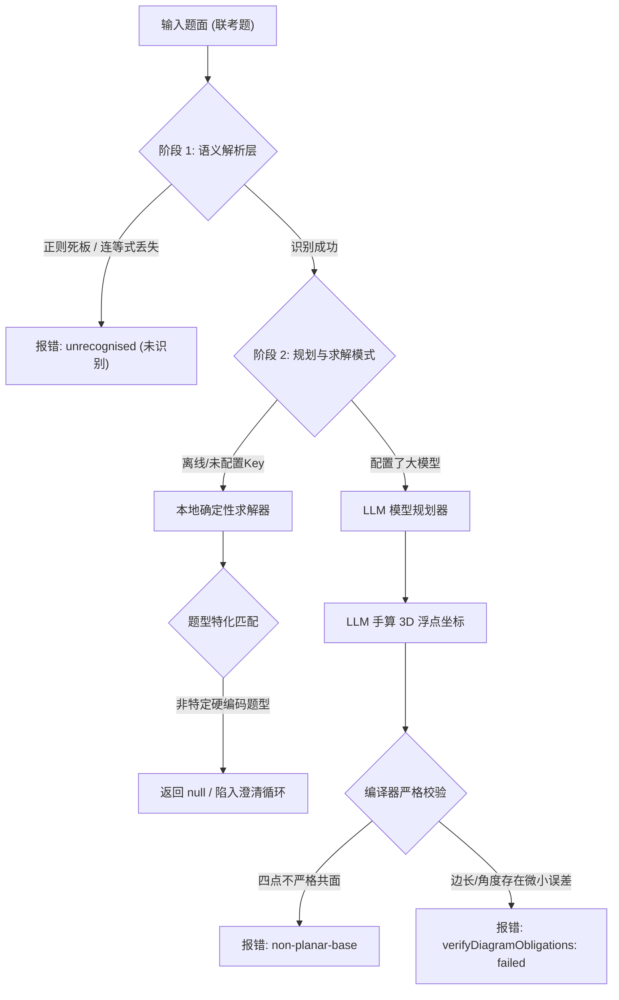

# MathCanvas 立体几何联考题作图失效分析与重构设计报告

**评估时间**：2026-11-05  
**代码版本**：`ebccf313` (MathCanvas v4.2.0 开发版)  
**涉及模块**：`packages/agent-core`、`packages/geometry-kernel`、`apps/web/src/agent`

---

## 1. 摘要与背景

在高中数学备考与立体几何实际教学场景中，大量试题源自高考真题或重点省市联考题（如九省联考、八省联考、名校期末质检等）。用户反馈在 MathCanvas Agent 中输入这类经典联考题时，**系统频繁报错、进入澄清循环或完全无法生成 3D 画布草稿（即“总是画不出来”）**。

经对 `packages/agent-core` 及其底层求解器与编译器进行代码走查和全链路追踪，本报告查明该现象的本质并非单一的大模型回答质量问题，而是**自然语言正则入口过度拘泥、底层求解器按题硬编码过拟合、缺乏通用参数化底面构造能力、以及要求大模型暴力手算空间浮点坐标**共同导致的系统性缺陷。

---

## 2. 经典联考真题基准测试集 (Benchmark Suite)

为系统复现并评估该问题，本报告筛选了 4 类覆盖高考与联考全场景的代表性真题：

```
                    ┌─────────────────────────┐
                    │  经典高中立体几何联考题  │
                    └───────────┬─────────────┘
          ┌─────────────────────┼─────────────────────┐
          ▼                     ▼                     ▼
┌───────────────────┐ ┌───────────────────┐ ┌───────────────────┐
│ Case 1: 直角梯形底 │ │ Case 2: 正三棱柱  │ │ Case 3: 菱形底    │
│ 侧棱垂直 (PA⊥底面) │ │ 棱上定比分点+斜截面 │ │ 对角线中心投影PO  │
└───────────────────┘ └───────────────────┘ └───────────────────┘
                                │
                                ▼
                      ┌───────────────────┐
                      │ Case 4: 空间翻折  │
                      │ 梯形沿对角线折起  │
                      └───────────────────┘
```

### Case 1：直角梯形底四棱锥，侧棱垂直底面（高频联考常客）
- **题面**：
  > 如图，在四棱锥 $P-ABCD$ 中，底面 $ABCD$ 为直角梯形，$AB \parallel CD$，$AD \perp AB$，$PA \perp \text{底面 } ABCD$，$PA = AB = AD = 2$，$CD = 1$。点 $E$ 为棱 $PB$ 的中点。  
  > (1) 求证：$AE \perp \text{平面 } PBC$；  
  > (2) 求直线 $PC$ 与平面 $ADE$ 所成角的正弦值。
- **几何特征**：非正多边形底面（直角梯形）、侧棱垂直底面、中点约束、连等式（$PA=AB=AD=2$）。
- **当前表现**：**彻底画不出**。本地规划器无法识别直角梯形底面；在线大模型计算四点共面浮点数经常超差被拒。

### Case 2：正三棱柱截面与棱上分点
- **题面**：
  > 如图，在正三棱柱 $ABC-A_1B_1C_1$ 中，底面边长 $AB = 2$，侧棱长 $AA_1 = 3$。点 $D$ 为棱 $AC$ 的中点，点 $E$ 在棱 $BB_1$ 上，且 $BE = 1$。  
  > (1) 证明：$A_1C \parallel \text{平面 } B_1DE$；  
  > (2) 求二面角 $A-DE-B_1$ 的余弦值。
- **几何特征**：正三棱柱命名角标映射（$A_1$ 与 $A'$ 统一）、侧棱任意分点（$BE=1$ 非中点）。
- **当前表现**：**画不出或丢失点名**。若无特定正则匹配，顶底环点名映射易丢失，非中点动点缺乏参数化绑定出口。

### Case 3：菱形底面四棱锥，顶点投影在中心
- **题面**：
  > 如图，在四棱锥 $P-ABCD$ 中，底面 $ABCD$ 是边长为 2 的菱形，$\angle BAD = 60^\circ$，$AC$ 与 $BD$ 相交于点 $O$。$PO \perp \text{平面 } ABCD$，$PO = \sqrt{3}$。点 $M$ 为棱 $PC$ 的中点。  
  > (1) 证明：$PA \parallel \text{平面 } BDM$；  
  > (2) 求点 $A$ 到平面 $PBD$ 的距离。
- **几何特征**：底面为 $60^\circ$ 菱形，顶点 $P$ 垂足落在对角线交点 $O$ 而非外周端点。
- **当前表现**：**彻底画不出**。底层求解器无菱形解析模板，大模型生成的菱形顶点经常在校验边长或对角线垂直时因浮点截断失败。

### Case 4：平面梯形沿公共线折叠（综合压轴题）
- **题面**：
  > 如图，在直角梯形 $ABCD$ 中，$AB \parallel CD$，$AD \perp AB$，$AB = 2$，$AD = CD = 1$。将 $\triangle ACD$ 沿 $AC$ 折起成 $\triangle PAC$，使得平面 $PAC \perp \text{平面 } ABC$。点 $M$ 为 $PB$ 的中点。  
  > (1) 证明：$AP \perp CD$；  
  > (2) 求二面角 $P-AB-C$ 的大小。
- **几何特征**：折叠前平面几何约束转换为折叠后三维刚体旋转。
- **当前表现**：**报错拦截**。现有折叠求解器（`rectangleFold.ts`）完全局限于“矩形沿对角线折叠”，对梯形折叠直接报不支持。

---

## 3. 技术根因深度剖析 (Root Cause Analysis)



### 根因 1：自然语言入口（`shapeGrammar.ts` / `obligationIR.ts`）过于死板
1. **句型前缀脆弱**：
   - 源码中的核心形状识别正则：
     ```ts
     const SHAPE_CLAUSE = /在\s*(正|斜|直)?\s*([三四五六])?\s*(棱锥|棱柱|棱台)\s*([A-Z][^\s，,。；;、]*?)\s*中/
     ```
   - 联考题开头往往是“`如图，在四棱锥...`”、“`在以直角梯形为底面的四棱锥...`”或直接“`四棱锥 P-ABCD 中`”。只要缺少“在”或中间插入描述性状语，正则匹配立刻落空，返回 `null`。
2. **连等式与复合约束截断**：
   - 联考题常见的“$PA=AB=AD=2$”、“$AB=2CD=4$”，`obligationIR` 仅解析首段赋值，后续等式被直接丢弃，导致几何系统因信息缺失判定为“欠定（under-determined）”或直接拒绝。

### 根因 2：本地求解器高度过拟合，一题一写缺乏泛化
查阅 `packages/agent-core/src/solver/` 下的现存求解器：
- [`perpendicularPyramid.ts`](file:///d:/draw/draw/packages/agent-core/src/solver/perpendicularPyramid.ts)：代码第 41 行赫然写着：
  ```ts
  const offset = length / Math.sqrt(3) // 针对特定题目特写
  ```
  该文件专门为“$PA \perp \text{底面} + AD=CD + \text{面 } PAC \perp \text{面 } PBD$”这一道题硬编码。
- [`pyramid.ts`](file:///d:/draw/draw/packages/agent-core/src/solver/pyramid.ts)：只支持“正方形底面 + $PC=PD$”，底面换成梯形或长方形即直接返回 `null`。
- [`trapezoidPrism.ts`](file:///d:/draw/draw/packages/agent-core/src/solver/trapezoidPrism.ts)：只处理给定体积为 36 的特定梯形直四棱柱。
- [`rightPrismPlan.ts`](file:///d:/draw/draw/packages/agent-core/src/rightPrismPlan.ts)：整段代码是用正则表达式强行匹配特定第 15 题的文字模式。

> **结论**：现有本地求解层实质上是一批“面向特定题目的探针”，缺乏处理常见几何体（直角梯形底四棱锥、菱形底四棱锥等）的通用解析生成能力。

### 根因 3：大模型直接手算 3D 浮点坐标，触发编译器严苛击毙
在在线大模型模式下，系统提示词要求 LLM 直接输出 `solid.create_polyhedron` 或 `solid.create_face` 的全部 3D 空间顶点浮点数组 `[{x, y, z}]`。
- **共面容差（`non-planar-base`）**：
  数学上直角梯形的 4 个点在底面上严格共面（$z=0$）。但当旋转坐标系或计算斜面时，大模型输出的浮点数即便仅有 $10^{-6}$ 的精度漂移，内核多边形共面检查就会当场抛出 `non-planar-base` 异常。
- **题设校验（`diagramVerification`）拦截**：
  模型算出的坐标只要导致任意一条边长计算值与题干数据有微小误差，系统就会打上 `failed` 标记，两轮尝试后直接放弃作图。

### 根因 4：缺乏高中立体几何语义的“宏装配动作”
当前 DSL 动作集过于底层：
- 要么是完全固化的模板（`cube`, `regular_pyramid`）；
- 要么是完全自由但极其繁琐的底层网格构建动作（`solid.create_polyhedron`）。
- **严重缺失高中立体几何标准特征原语**，例如：
  - “以特征多边形为底、顶点沿垂线投影在某点”的四棱锥装配原语；
  - “以平面多边形拉伸指定高度”的直棱柱装配原语；
  - “按比例在指定空间线段上建立动点”的语义动作。

---

## 4. 架构重构与解决方案设计

为从根本上解决作图失败问题，提出 **“分层解耦、参数化装配、符号与解析优先”** 的三层架构方案：

```
                [自然语言题面 / 联考题]
                          │
                          ▼
┌────────────────────────────────────────────────────────┐
│ 1. 语义入口鲁棒增强 (Semantic Robust Normalizer)       │
│    - 容纳 "如图"、"设"、"已知" 等常见前缀修饰词         │
│    - 连等式自动展开 (如 PA=AB=AD=2 展开为 3 组等式)     │
│    - 提取三大空间特征: 几何体大类 + 底面类型 + 顶点投影 │
└─────────────────────────┬──────────────────────────────┘
                          │
                          ▼
┌────────────────────────────────────────────────────────┐
│ 2. 空间几何参数化构造器 (Parametric Solid Builder)     │
│    - 底面生成器: 覆盖矩形/正方形/直角梯形/等腰梯形/菱形 │
│    - 锥顶投影生成器:                                    │
│        * Case 1: 侧棱垂直底面 (如 PA ⊥ 底面)           │
│        * Case 2: 顶点投影在底面几何中心/对角线交点/中点│
│    - 保证坐标数学级精确(解析解)，彻底消除 LLM 浮点残差 │
└─────────────────────────┬──────────────────────────────┘
                          │
                          ▼
┌────────────────────────────────────────────────────────┐
│ 3. 增加高层几何宏动作 (Macro Actions)                  │
│    - solid.create_pyramid_parametric (参数化棱锥)       │
│    - solid.create_prism_parametric (参数化直棱柱)       │
│    - 动点分棱动作自动关联已有拓扑棱 (hostEdge, ratio)   │
└────────────────────────────────────────────────────────┘
```

### 模块 1：入口语法与连等式归一化器 (Normalizer)
1. **模式容错拓展**：
   改写 `shapeGrammar.ts`，支持可选前缀（`如图[,，]?`、`已知`）以及谓语插入（如`在以...为底面的...中`）。
2. **连等式预处理展开**：
   在 `obligationIR.ts` 中引入连等式分解器：
   - 将 `PA = AB = AD = 2` 自动归一化为 3 条独立条件：`PA=2`、`AB=2`、`AD=2`；
   - 将 `AB = 2CD = 4` 分解为：`AB=4`、`CD=2`。

### 模块 2：高中立体几何通用参数化求解器 (Parametric Solid Builder)
在 `packages/agent-core/src/solver/` 中引入通用模块 `parametricPyramid.ts` 与 `parametricPrism.ts`，解耦底面与高度计算：

```typescript
// 1. 底面特征描述
export type BasePolygonSpec = 
  | { kind: "rectangle"; a: number; b: number; names: [string, string, string, string] }
  | { kind: "right-trapezoid"; bottom1: number; bottom2: number; height: number; names: [string, string, string, string] }
  | { kind: "rhombus"; edge: number; angleDegrees: number; names: [string, string, string, string] }
  | { kind: "triangle"; a: number; b: number; c?: number; angleDegrees?: number; names: [string, string, string] }

// 2. 锥顶投影与高描述
export type ApexProjectionSpec =
  | { kind: "corner-perpendicular"; cornerName: string; height: number } // 如 PA ⊥ 底面
  | { kind: "center-perpendicular"; height: number }                     // 投影在底面对角线交点/中心
  | { kind: "midpoint-perpendicular"; edge: [string, string]; height: number } // 投影在某边中点

// 3. 通用解析装配函数
export function constructParametricPyramid(
  apexName: string, 
  base: BasePolygonSpec, 
  apex: ApexProjectionSpec
): { vertices: Vector3[]; vertexNames: string[]; faces: number[][] }
```
- **核心优势**：纯解析三角计算，所有底面顶点严格处于 $z=0$ 平面，**100% 杜绝非共面报错**。
- **大模型职责转变**：大模型无需计算浮点坐标，只需从题干中提取出 `{ base: "right-trapezoid", bottom1: 2, bottom2: 1, height: 2, pa: 2 }` 这类结构化参数。

### 模块 3：拓扑宏动作支持与自适应核验
1. **提供宏动作**：在 DSL 与 Action 注册表中增加 `solid.create_pyramid_parametric` 与 `solid.create_prism_parametric`。
2. **点名自动绑定**：棱上点（如中点 $E$）直接基于拓扑棱（如 `hostEdge: ["P", "B"]`, `parameter: 0.5`）生成，不要求手动计算空间中点坐标。
3. **核验公差自适应**：在 `diagramVerification.ts` 中针对解析计算引入统一的特征尺度自适应容差，避免无意义的微小截断误差拒绝。

---

## 5. 实施路线图与落地计划

| 阶段 | 核心任务 | 交付目标 | 预估周期 |
| :--- | :--- | :--- | :---: |
| **第一阶段 (P1)** | **语法入口与连等式预处理** | 改造 `shapeGrammar.ts` 与 `obligationIR.ts`，通过 4 道基准题的语义提取 | 1-2 天 |
| **第二阶段 (P2)** | **通用参数化四棱锥/三棱柱求解器** | 实现直角梯形、菱形底面与各类垂直投影的纯数学参数化生成；杜绝 `non-planar-base` | 2-3 天 |
| **第三阶段 (P3)** | **Agent 提示词与宏动作集成** | 更新 `systemPrompt.ts` 与 `localPlanner.ts`，使基准测试集 4 道题全绿通过 | 2 天 |

---

## 6. 关键决策建议

1. **坚持“大模型做结构提取，代码内核做几何运算”的原则**：不要试图微调或要求大模型提高 3D 浮点数计算精度，大模型天生不擅长精确三维代数几何，交给 TypeScript 解析解是唯一稳定可靠的路径。
2. **保留既有变式测试作为回归安全网**：所有新改动必须在现有的 `examSolidVariants.test.ts`、`explicit-solid-acceptance` 及文档一致性测试集上全量保持绿灯。
