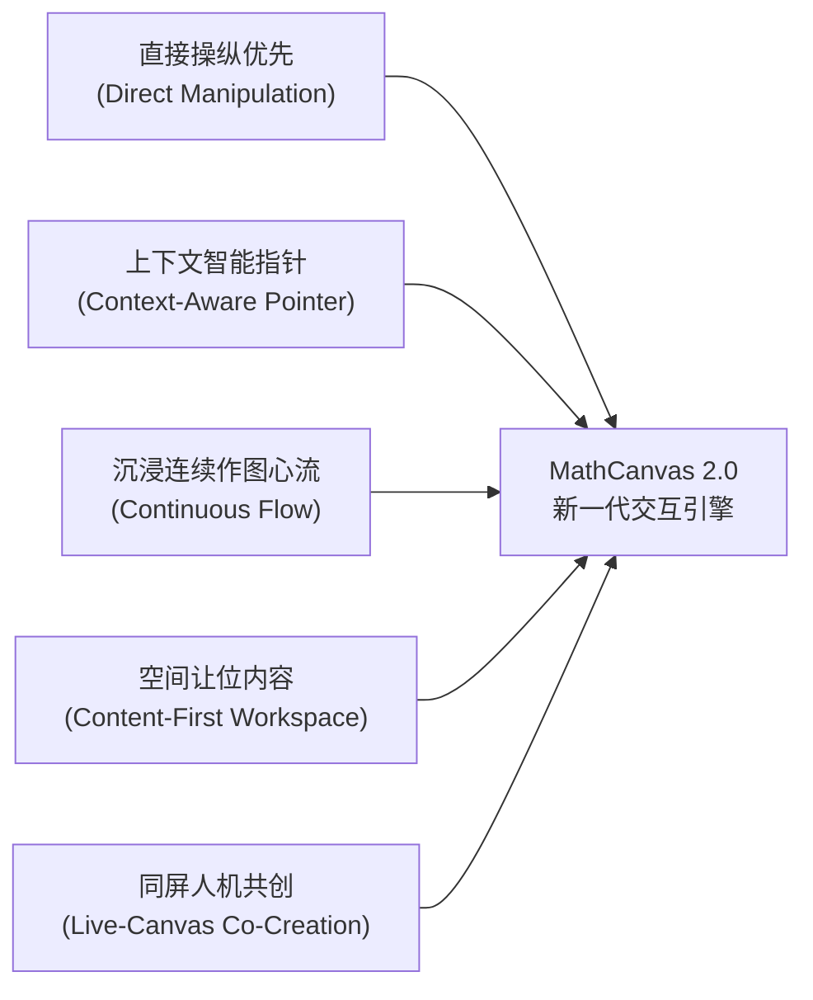
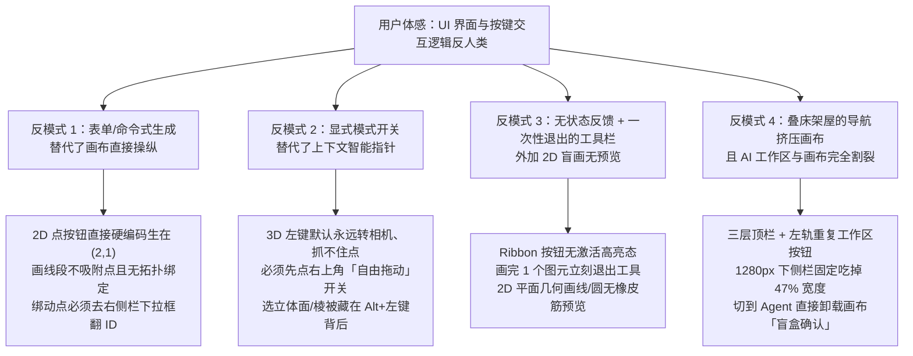
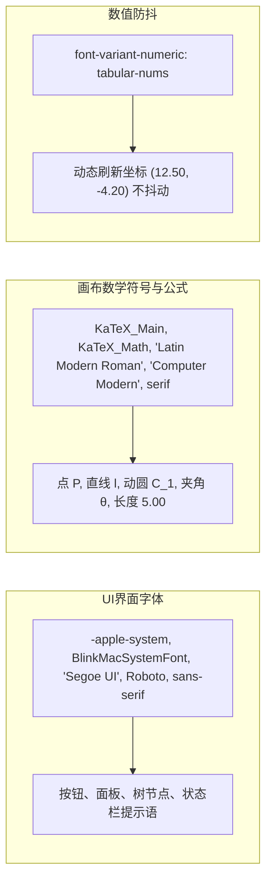
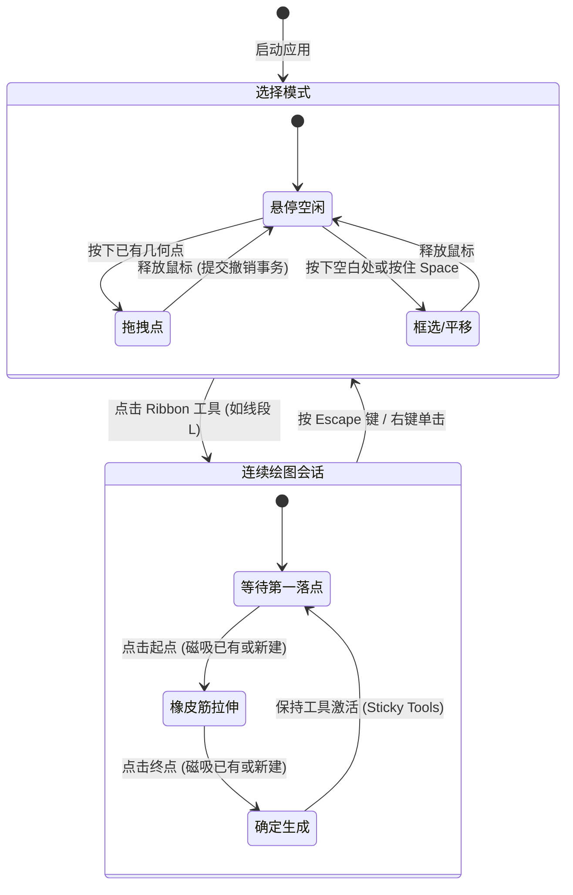
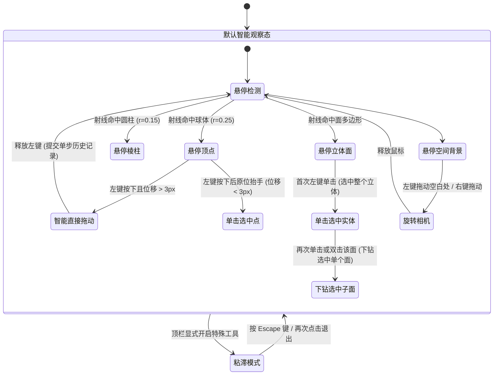
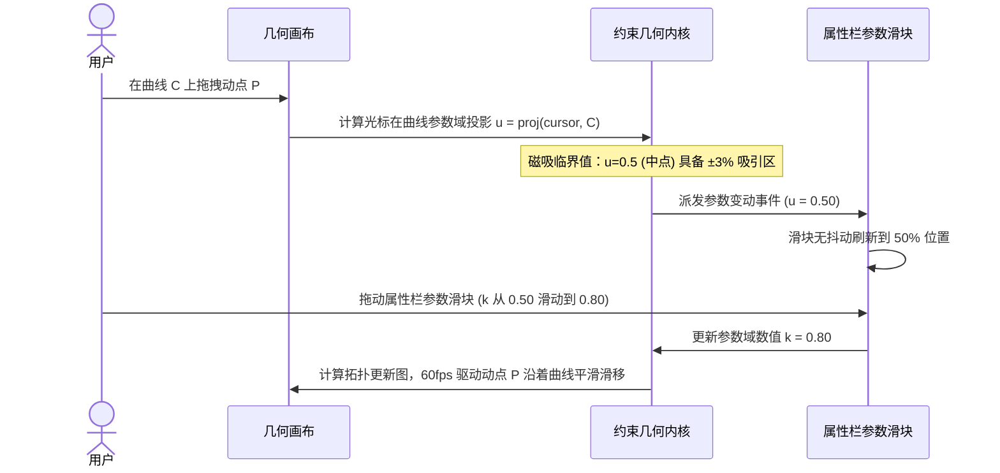
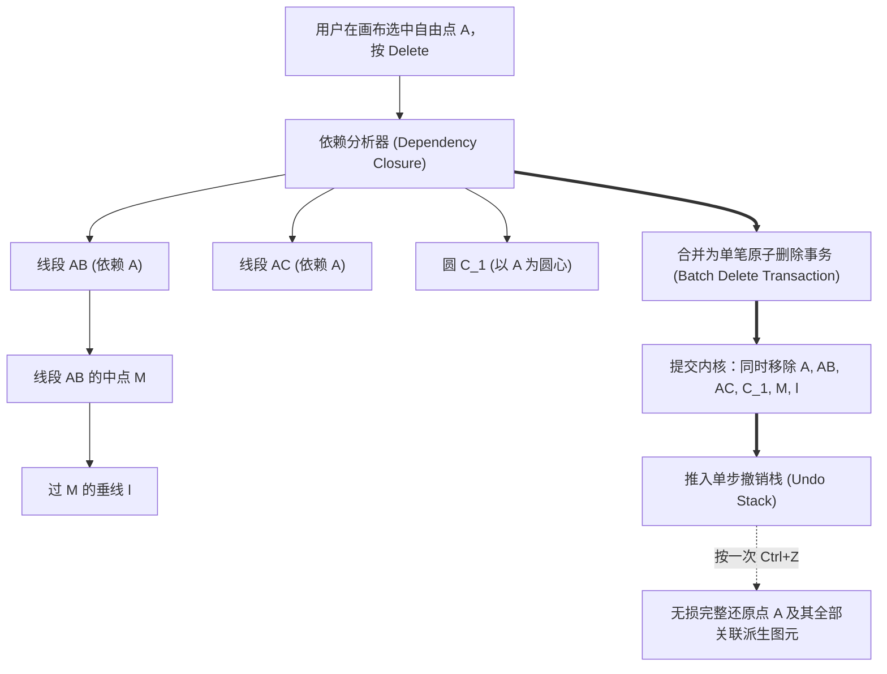
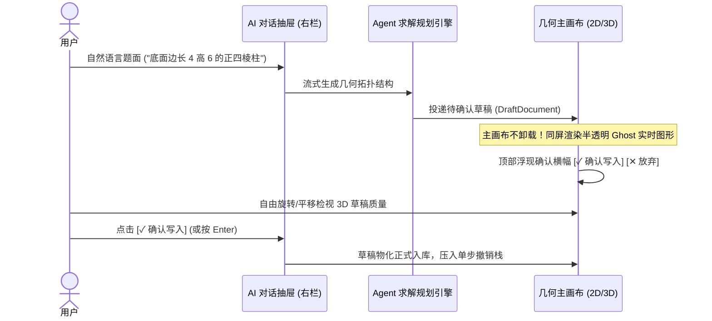

# MathCanvas 交互体验与界面设计（UI/UX）完整规范及重构方案

> **文档状态**：第一阶段（核心微观手感 + 宏观布局与命令面板）已落地实现并全量单测验证通过（501 文件 / 5344 项全绿）  
> **基准版本**：基于 2026-11-02 状态与代码基准对齐  
> **关联文档**：[`docs/current-status.md`](../../current-status.md) · [`CHANGELOG.md`](../../../CHANGELOG.md) · [`docs/project-progress.md`](../../project-progress.md) · [`docs/feature-catalog.md`](../../feature-catalog.md)

---

## 目录
- [一、核心愿景与设计哲学（Vision & Core Philosophy）](#一核心愿景与设计哲学vision--core-philosophy)
- [二、全量痛点诊断与代码溯源（Problem Inventory & Code Traceability）](#二全量痛点诊断与代码溯源problem-inventory--code-traceability)
- [三、专业几何与 CAD 软件交互基准对照（Industry Benchmark Matrix）](#三专业几何与-cad-软件交互基准对照industry-benchmark-matrix)
- [四、视觉设计系统与设计变量规范（Visual Design System & Design Tokens）](#四视觉设计系统与设计变量规范visual-design-system--design-tokens)
- [五、宏观工作台布局与壳层架构（App Shell 2.0 & Workspace Architecture）](#五宏观工作台布局与壳层架构app-shell-20--workspace-architecture)
- [六、微观交互与指针动力学深度规约（Micro-Interactions & Pointer Dynamics）](#六微观交互与指针动力学深度规约micro-interactions--pointer-dynamics)
- [七、AI Copilot 同屏人机共创规约（Live-Canvas Co-Creation Specification）](#七ai-copilot-同屏人机共创规约live-canvas-co-creation-specification)
- [八、键盘交互与无障碍规范（Shortcuts & Accessibility Matrix）](#八键盘交互与无障碍规范shortcuts--accessibility-matrix)
- [九、技术架构与组件落地映射（Implementation Architecture & Component Map）](#九技术架构与组件落地映射implementation-architecture--component-map)
- [十、实施路线图与质量门禁（Roadmap & Verification Gate）](#十实施路线图与质量门禁roadmap--verification-gate)

---

## 一、核心愿景与设计哲学（Vision & Core Philosophy）

MathCanvas 致力于打造面向现代数学教学、工程制图与大模型协作的专业级几何计算工作台。为了彻底根除传统版本中“按键反人类、操作不跟手、逻辑脱节”的体感痛点，整体设计遵循以下五大核心交互原则：



### 1.1 五大设计原则诠释

1. **直接操纵优先（Direct Manipulation Over Form Filling）**：
   - 几何构图的核心在于视觉化直觉。坚决杜绝“在右侧栏下拉菜单中翻查数十个对象 ID 绑定动点”或“点击按钮在固定坐标堆叠图元”的表单式操作；
   - 所有的几何对象（点、线、圆、多边形、空间面）均以画布为第一交互载体，支持在画布上直观完成吸附、落点、连线与拉伸。

2. **上下文智能指针（Context-Aware Pointer）**：
   - 告别繁琐的显式模式切换开关（如 3D 视口中频繁开关“自由拖动 / 旋转视角 / 取面”）；
   - 指针根据光标悬停与按下的物理目标自动决策行为：按住几何点即拖动点，按住手柄即缩放/旋转，按在空白处即旋转相机或框选，按住修饰键（Shift/Space）即平移画布。

3. **沉浸连续作图心流（Continuous Flow & Sticky Tools）**：
   - 绘图工具支持连续激活（Sticky Tools），画完一个图元保持工具激活态，支持连续构建复杂几何结构（如连线构成多边形）；
   - 提供全流程毫秒级反馈，在落点瞬间提供清晰的锚点指示与橡皮筋（Rubber-band）虚线预览，辅以按 `Esc` 或右键一键退出的轻量解脱机制。

4. **空间让位内容（Content-First Workspace & Zero-Clutter）**：
   - 界面的一切装饰与边框必须克制。移除无功能的装饰性动画顶栏，压缩多层嵌套导航；
   - 桌面端左右侧边栏支持随时一键收缩折叠，将 100% 的可视空间交还给几何画布，消除死灰留白，保持坐标网格视口最大化。

5. **同屏人机共创（Live-Canvas Co-Creation）**：
   - 大模型数学助手（AI Copilot）不再是切断主画布的全屏纯文本聊天框，而是可同屏并排展开的对话抽屉；
   - Agent 输出的草稿直接在主画布上以半透明“幻影模式（Ghost Preview）”实时并存呈现，支持用户 360 度交互检视后再行确认落盘。

### 1.2 心智模型与系统模型对齐（Mental vs System Model）

```mermaid
graph TD
    subgraph 用户心智模型 (User Mental Model)
        U1["我看到点 A，我按住就想拖动它"]
        U2["我选线段工具，点击点 A 再移鼠标，应该有一条虚线拉出来跟随鼠标"]
        U3["我输入一道几何题，图形应该在画布上直接长出来，我不满意可以顺手修改"]
    end

    subgraph 系统内部实现模型 (System Implementation Model)
        S1["Graph 拓扑图节点与引用关系 (ID: pt_abc123)"]
        S2["参数方程曲线投影与投影矩阵 (u ∈ [0, 1])"]
        S3["Three.js 场景图、射线拾取 (Raycaster) 与 OrbitControls 状态机"]
    end

    U1 <==>|"12px 磁吸 + 智能抓取直通"| S1
    U2 <==>|"橡皮筋引擎 (Rubber-band Preview)"| S2
    U3 <==>|"Ghost 实时同屏渲染 + 确认事务"| S3
```

---

## 二、全量痛点诊断与代码溯源（Problem Inventory & Code Traceability）

通过对 `apps/web/src` 全部组件、命令分发、指针事件处理与样式表的逐行审计，并与主流动态几何及设计软件对比，系统梳理出**四大底层设计反模式**与**20 项代码级查实缺陷**。



### 2.1 二十项查实交互缺陷与源码定位矩阵

| 编号 | 缺陷分类 | 具体现象描述 | 源码定位 | 影响级别 | 根因与优化规约 |
| :--- | :--- | :--- | :--- | :--- | :--- |
| **A1** | 输入与热键 | 2D 画布全局无条件拦截 `Space` 键，导致所有文字输入框、公式编辑框与搜索框打不出空格 | [`GraphicsView.tsx`](../../../../apps/web/src/components/GraphicsView.tsx#L460-L467) | **P0 阻断** | `keydown` 监听缺少 `isTextEditingTarget(e.target)` 过滤，已落地修护 |
| **A2** | 盲画与预览 | 2D 平面几何画布缺失橡皮筋实时预览，画线/画圆第一下落点后无任何视觉反馈（盲画） | [`App.tsx`](../../../../apps/web/src/App.tsx#L715) · [`GraphicsView.tsx`](../../../../apps/web/src/components/GraphicsView.tsx#L33-L45) | **P0 严重** | `<GraphicsView />` 未接收 `creationStep`，已补齐虚线预览与浮动读数 |
| **A3** | 工具状态反馈 | Ribbon 工具按钮没有任何激活高亮态（Active State），用户完全不知道当前处于何种工具 | [`AppChrome.tsx`](../../../../apps/web/src/components/AppChrome.tsx#L40) · [`Ribbon.tsx`](../../../../apps/web/src/components/Ribbon.tsx#L153) | **P0 严重** | 补齐 `activeCommandId` 与 `data-active`、`aria-pressed` 属性 |
| **A4** | 文案与落点欺骗 | 2D “添加点”文案提示“在空白处单击创建点”，点击按钮后直接在硬编码坐标 `(2, 1)` 重复堆叠 | [`ribbonCommands.ts`](../../../../apps/web/src/ribbonCommands.ts#L36) · [`point3ToolCommands.ts`](../../../../apps/web/src/point3ToolCommands.ts#L48-L56) | **P0 严重** | 改造为画布就绪落点模式，点击画布空白处在光标位置生成自由点 |
| **B1** | 拓扑直接操纵 | 2D 画线段不吸附已有几何点，生成硬编码绝对坐标，移动端点线段不跟随；连线需在右侧栏点按 | [`GraphicsView.tsx`](../../../../apps/web/src/components/GraphicsView.tsx#L366) · [`draftingCommands.ts`](../../../../apps/web/src/draftingCommands.ts#L84-L114) | **P1 高** | 引入 12px 磁吸引擎，优先捕捉已有几何点 ID，形成拓扑关联 |
| **B2** | 动点绑定表单化 | 动点路径绑定被迫在右侧属性栏 `<select>` 下拉框中从几十个图元 ID 里翻查 | [`PropertiesBar.tsx`](../../../../apps/web/src/components/PropertiesBar.tsx#L126) | **P1 高** | 支持点工具悬停在曲线/棱线上直接点击生成宿主约束动点 |
| **B3** | 作图流被打断 | 绘图工具一次性自动退出（One-Shot Reset），画完一条线立即退回，画三角形需点 3 次工具 | [`draftingCommands.ts`](../../../../apps/web/src/draftingCommands.ts#L90) · [`App.tsx`](../../../../apps/web/src/App.tsx#L388) | **P1 高** | 引入 Sticky Tools 连续作图模式，按 Esc 或右键退出 |
| **B4** | 3D 指针抓取断层 | 3D 视口左键默认永远旋转相机，直接点击点也拖不动；必须先在右上角打开“自由拖动”开关 | [`threeSceneInteraction.ts`](../../../../apps/web/src/threeSceneInteraction.ts#L191-L264) · [`threeScene.tsx`](../../../../apps/web/src/threeScene.tsx#L128) | **P1 高** | 引入智能直抓（Direct Point Dragging）：射线命中点且位移直接拖动 |
| **B5** | 3D 子图元隐蔽 | 3D 立体几何的单个面、棱拾取被锁死在毫无提示的 `Alt + 左键` 之后 | [`threeSceneInteraction.ts`](../../../../apps/web/src/threeSceneInteraction.ts#L204) | **P1 高** | 引入渐进式下钻选择（单击选整体立体，双击选子面/子棱） |
| **B6** | 模式逃逸失效 | 3D 视口进入“平移/自由拖动/取面”等粘滞模式后按 `Escape` 键无法退出 | [`threeScene.tsx`](../../../../apps/web/src/threeScene.tsx#L131-L157) | **P1 高** | 全局 Esc 侦听器解绑粘滞模式，秒级回退默认观察态 |
| **C1** | 删除级联阻断 | 选中点 A 按 Delete 直接报错“对象被另一个对象引用”拒绝删除，逼迫用户手动先删线再删点 | [`App.tsx`](../../../../apps/web/src/App.tsx#L400-L420) | **P1 高** | 引入智能级联删除闭包（Cascade Delete）并支持单步 Ctrl+Z 还原 |
| **C2** | 几何构造逆直觉 | 垂线、平行线、角平分线、切线无顶栏直接工具入口，必须先按住 Shift 盲选特定图元再找右侧栏 | [`PropertiesBar.tsx`](../../../../apps/web/src/components/PropertiesBar.tsx#L280-L310) | **P1 高** | 顶栏 Ribbon 显式增加“几何构造”与“测量标注”直接下拉工具组 |
| **C3** | 缺乏右键菜单 | 画布右键无上下文快捷菜单，删除、重命名、隐藏、属性修改必须远距离移动光标去侧栏 | [`GraphicsView.tsx`](../../../../apps/web/src/components/GraphicsView.tsx) · [`threeScene.tsx`](../../../../apps/web/src/threeScene.tsx) | **P2 中** | 引入画布原生样式右键上下文菜单（Context Menu） |
| **C4** | 重命名路径冗长 | 点或直线无法直接双击标签重命名，必须去右侧属性面板找到输入框改名 | [`PropertiesBar.tsx`](../../../../apps/web/src/components/PropertiesBar.tsx#L68) | **P2 中** | 支持双击画布上的标签文字，原地弹出微型内嵌输入框内联改名 |
| **C5** | 键盘微调缺失 | 选中点后无法使用键盘方向键微调坐标，无法实现像素级对齐 | 全局事件处理 | **P2 中** | 支持方向键以 0.1 / 1.0 步长微调选中自由点坐标 |
| **C6** | 命令发现效率低 | 顶部搜索框无全局快捷键唤起，无模糊打分排序，按回车无法直接激活工具 | [`WorkspaceTabs.tsx`](../../../../apps/web/src/components/WorkspaceTabs.tsx) | **P2 中** | 引入标准 Ctrl+K 全局命令面板，支持模糊评分与方向键导航 |
| **D1** | 壳层空间重叠 | 页面顶部存在三层不同高度的导航条，左侧侧轨与顶栏出现功能完全重复的工作区切换按钮 | [`AppChrome.tsx`](../../../../apps/web/src/components/AppChrome.tsx#L30-L50) · [`WorkspaceRail.tsx`](../../../../apps/web/src/components/WorkspaceRail.tsx) | **P1 高** | 合并为极简单行顶栏（40px），收拢工作区切换与文件操作 |
| **D2** | 侧栏挤压视口 | 左右侧边栏固定占用 604px 宽度且不可折叠，1280px 屏幕下画布仅剩 53% 视口面积 | [`global.css`](../../../../apps/web/src/styles/global.css#L156-L170) | **P1 高** | 增加左右侧边栏一键收缩折叠能力，释放 100% 弹性视口 |
| **D3** | 画布固定留白 | 2D 平面几何画布锁定 800×440 固定像素尺寸，桌面大屏下方产生大片死灰留白空隙 | [`global.css`](../../../../apps/web/src/styles/global.css#L225) · [`GraphicsView.tsx`](../../../../apps/web/src/components/GraphicsView.tsx#L25) | **P1 高** | 画布升级为 Flex 弹性全屏自适应，彻底消除空白死区 |
| **D4** | AI 盲盒割裂 | 切换至 Agent 模式时将 2D/3D 画布完全卸载，生成的几何草稿只有数字统计表，无法在画布实时预览 | [`App.tsx`](../../../../apps/web/src/App.tsx#L680-L730) | **P0 严重** | 改造为 AI Copilot 侧边抽屉 + 画布半透明 Ghost 实时并存预览 |
| **D5** | 输入法回车误触 | AI 对话输入框在中文输入法（IME）选词敲回车时直接误触发提交发送 | [`AgentComposer.tsx`](../../../../apps/web/src/components/agent/AgentComposer.tsx#L70) | **P1 高** | 全面落地 `ime-safe-enter-submit`，带 50ms 组合窗安全保护 |

---

## 三、专业几何与 CAD 软件交互基准对照（Industry Benchmark Matrix）

通过深度调研国内外主流专业几何工具（GeoGebra 6、Desmos Geometry）、工业 CAD 软件（AutoCAD、SolidWorks）及现代设计生产力软件（Figma、Blender），提炼出 10 项核心体验维度的对照基准：

| 交互维度 | GeoGebra 6 / Desmos Geometry | Figma / AutoCAD / Blender | MathCanvas 传统实现（痛点） | MathCanvas 2.0 优化落地目标 |
| :--- | :--- | :--- | :--- | :--- |
| **1. 画点与动点绑定** | 选点工具：点空白处生自由点；点在曲线/棱/面上直接绑定为动点；点两线交汇处直接生成交点 | 选点/节点工具直接在路径上落点，悬停实时高亮吸附目标，一击绑定 | 点按钮直接在 (2,1) 硬编码堆叠；动点必须先建自由点，再去右侧栏下拉框翻查曲线 ID | **统一画布直接落点**：点击空白处生自由点，悬停并点击线/面自动绑定为动点，点击交点自动生成交点 |
| **2. 画线/圆与拓扑连接** | 选线/圆工具：点击已有端点自动吸附引用，点击空白处自动建新点并建立拓扑关联 | 实时显示起点锚点 + 鼠标跟随橡皮筋预览线（Rubber-band）+ 浮动尺寸/角度读数 | 无橡皮筋预览（盲画）；画出的线段是死坐标，不吸附端点也不随端点移动；连线需在右侧栏点按 | **全程橡皮筋预览 + 12px 磁吸捕捉**：点击已有端点建立拓扑引用，点空白处自动建点，拖动端点线段自动跟随 |
| **3. 工具持续性（Sticky）** | 选中绘图工具后保持激活，可连续绘制多个图元；按 Esc 或点移动工具退出 | 连续命令流（Esc/Enter/右键结束）；工具栏强高亮当前激活工具 | Ribbon 按钮无激活高亮；画完 1 个图元立刻强制退出工具模式，画三角形需往返点 3 次顶栏 | **工具栏强高亮 + 连续作图心流**：同一工具持续激活，支持按 Esc 或右键一键退回选择模式 |
| **4. 3D 视口指针手势** | 左键点中可动点直接拖拽；左键拖空白处或右键拖动旋转视角；滚轮缩放；无需手动切模式 | 点击手柄/控制点直接变换物体；中键/右键旋转或平移相机；手势自适应 | 左键默认永远旋转相机，点击 3D 点也拖不动；必须先去右上角打开“自由拖动”开关才能拖点 | **上下文智能指针**：左键命中点/手柄直接拖动；左键拖空白处或右键拖动旋转相机；Shift+拖动平移视口 |
| **5. 3D 立体子图元拾取** | 直接点击立体的顶点、棱、面即可选中对应元素并高亮；无需隐藏快捷键 | 单击选整体、双击进入组件/顶点/棱/面层级下钻拾取；支持框选 | 直接点击面强制选中整个立体；必须按住毫无提示的 Alt+左键才能选单个面或棱 | **渐进式层级拾取**：单击选中整体立体，双击下钻选中单个子面或子棱；保留 Alt 快捷直通选择 |
| **6. 测量与几何构造入口** | 顶栏直接提供“角度/距离/面积/切线/垂线/中点”工具，选工具后在画布依次点选目标 | 顶栏显式提供测量（Measure）与几何约束工具组，支持快捷检索 | 顶部无入口；必须先知道用 Shift 选特定数量的点/面，再去右侧属性栏最底部找动态出现的按钮 | **双向可达**：既保留“先选图元→右侧栏快捷动作”，又在顶栏显式提供“测量与标注 / 几何构造”直接工具组 |
| **7. 删除与依赖处理** | 删除点 A 时自动级联删除依赖点 A 的线、面，按一次 Ctrl+Z 可完整恢复全部关联图元 | 删除父节点时级联清理或弹出确认；支持撤销树 | 选中点 A 按 Delete 直接报红字错拒绝删除，逼迫用户手动先在画布上找齐所有连线删完才能删点 | **智能级联删除（Cascade Delete）**：删除点或宿主时自动收集所有下游依赖合并为单笔事务一并删除，单步 Ctrl+Z 完整还原 |
| **8. 键盘与画布快捷交互** | Space 按住平移画布（输入框内打空格正常）；右键对象弹出属性菜单；双击标签直接改名 | V/P/L/C 单键切工具；方向键微调坐标；Ctrl+S/O/D；右键完备上下文菜单 | 全局拦截 Space 导致输入框打不出空格；无右键菜单；无双击改名；Esc 退不出 3D 模式 | **专业级键鼠体验**：修复输入框 Space 拦截；补齐右键菜单、双击标签内联改名、方向键微调、Ctrl+K 命令面板与全状态 Esc 退出 |
| **9. 壳层布局与画布占比** | 极简单行顶栏（40px），左右侧栏可一键折叠/拖拽调宽，画布占屏幕面积 80%+ | 画布 100% 填满视口，工具栏紧凑居中或靠边悬浮 | 三层顶栏 + 左轨重复工作区按钮；左右栏固定吃掉 604px 且不可折叠；2D 画布锁死 800×440 留白 | **单行紧凑顶栏 + 可折叠侧栏 + 100% 响应式自适应画布**，桌面端有效工作面积大幅释放至 80%+ |
| **10. AI 辅助作图工作流** | 侧边栏对话与主画布同屏并排，生成结果直接在主画布实时预览对比 | Copilot 侧边抽屉，主画布实时 Ghost 预览，一键 Apply / Discard | 切到 Agent 直接卸载整个画布；确认面板只有文字统计表，无任何图形预览（盲盒确认） | **AI Copilot 侧边抽屉 + 画布实时 Ghost 预览**：对话与画布同屏并排，待确认草稿在主画布半透明高亮预览与交互检视 |

---

## 四、视觉设计系统与设计变量规范（Visual Design System & Design Tokens）

MathCanvas 采用**现代冷色调微拟物（Modern Cold Skeuomorphism）**与**学术严谨风（Scholarly Precision）**。界面视觉干净、克制、聚焦数学内容本身，以轻微漫反射阴影和极浅分割线构建空间层级。

### 4.1 色彩系统与语义 Token 字典（Color Tokens）

```
+-----------------------------------------------------------------------------------------------------+
| 类别            | Token 名称                       | 浅色值 (Light)       | 深色值 (Dark)       | 语义说明与应用场景                |
| :---            | :---                             | :---                 | :---                 | :---                             |
| **基础表面**    | `--color-canvas`                 | `#F8FAFC` (冷灰白)  | `#0F172A` (深板岩) | 应用大背景与 2D/3D 画布底色        |
|                 | `--color-panel`                  | `#FFFFFF` (纯白)    | `#1E293B` (板岩灰) | 工具栏、面板、卡片、浮动浮标表面  |
|                 | `--color-surface-subtle`         | `#F1F5F9` (极浅灰)  | `#334155`          | 控件底色、禁用态、未选 Tab        |
|                 | `--color-surface-hover`          | `#E2E8F0`          | `#475569`          | 列表项、按钮悬停背景              |
| **边界分割**    | `--color-border`                 | `#E2E8F0` (柔和灰)  | `#334155`          | 面板外框、卡片分割线、工具栏底边  |
|                 | `--color-hairline`               | `#CBD5E1` (发丝线)  | `#475569`          | 滚动条滑块、微弱轮廓线            |
|                 | `--color-border-focus`           | `#3D5A80` (主焦点)  | `#60A5FA`          | 输入框焦点轮廓、激活边框          |
| **文字层级**    | `--color-ink`                    | `#1E293B` (深板岩蓝)| `#F8FAFC` (纯白字) | 标题、正文、重点数值、图标主色    |
|                 | `--color-muted`                  | `#64748B` (石板中灰)| `#94A3B8`          | 说明文本、副标签、快捷键提示      |
|                 | `--color-disabled`               | `#94A3B8`          | `#64748B`          | 禁用文字、占位符文字              |
| **品牌主色**    | `--color-accent`                 | `#3D5A80` (板岩青蓝)| `#60A5FA` (天青蓝) | 选中图元描边、主操作按钮、焦点环  |
|                 | `--color-accent-soft`            | `rgba(61,90,128,0.12)` | `rgba(96,165,250,0.2)` | 悬停态底色、激活高亮底色          |
|                 | `--color-accent-strong`          | `#293E56`          | `#93C5FD`          | 激活文字色、按下状态              |
| **几何语义**    | `--color-geo-point`              | `#1E293B`          | `#F8FAFC`          | 2D/3D 自由顶点                    |
|                 | `--color-geo-point-snap`         | `#3D5A80`          | `#60A5FA`          | 磁吸捕捉命中光圈                  |
|                 | `--color-geo-line`               | `#8B2635` (深红褐)  | `#F87171`          | 2D/3D 直线与线段                  |
|                 | `--color-geo-curve`              | `#3D5A80` (板岩蓝)  | `#38BDF8`          | 圆、椭圆、圆锥曲线                |
|                 | `--color-geo-moving`             | `#2F6F4F` (深松绿)  | `#34D399`          | 动点、旋转动圆、滑动参数控制点    |
|                 | `--color-geo-pivot`              | `#D94A4A` (珊瑚红)  | `#FB7185`          | 定点旋转标记、特征焦点            |
|                 | `--color-geo-warning`            | `#D97706` (琥珀金)  | `#FBBF24`          | 交点预览、约束冲突警告标记        |
|                 | `--color-geo-auxiliary`          | `#94A3B8` (辅助灰)  | `#64748B`          | 辅助延长线、垂足线、对称轴 (虚线) |
|                 | `--color-geo-ghost`              | `rgba(61,90,128,0.45)` | `rgba(96,165,250,0.45)`| AI 草稿半透明预览 (Ghost Mode)   |
+-----------------------------------------------------------------------------------------------------+
```

### 4.2 数学排印与衬线标签系统（Typography & Math Fonts）



1. **数学衬线体（Math Serif）**：
   - 2D SVG 与 3D 空间标签层上的所有几何符号（如 $A$、$B$、$l_1$、$C_1$、$	heta$）及测量公式，统一采用专业数学排版字体；
   - 杜绝使用无衬线黑体渲染斜体数学字母，确保具备学术教科书般的严谨美感。
2. **等宽数字（Tabular Numbers）**：
   - 所有动态刷新的数值显示区域（状态栏实时坐标、属性栏参数滑块读数、橡皮筋尺寸浮标），统一应用 `font-variant-numeric: tabular-nums`，消灭字符宽度跳变引起的界面闪烁。

### 4.3 间距、圆角、阴影与动效标尺（Design Metrics）

1. **间距系统（4px 基础网格）**：
   - `--space-1: 4px` · `--space-2: 8px` · `--space-3: 12px` · `--space-4: 16px` · `--space-5: 20px` · `--space-6: 24px` · `--space-8: 32px`。
2. **圆角规范**：
   - `--radius-sm: 4px`（按钮、输入框、微型标签、滑块手柄）；
   - `--radius-md: 8px`（面板卡片、上下文菜单、弹层浮标）；
   - `--radius-lg: 12px`（大模态框、画布边框、抽屉边角）；
   - `--radius-full: 9999px`（药丸形状态徽标、磁吸光圈）。
3. **空间弥散阴影层级（Elevation & Shadows）**：
   - **Level 0（平整层）**：`none`（主画布背景）；
   - **Level 1（卡片/工具栏）**：`box-shadow: 0 1px 3px 0 rgba(0,0,0,0.06), 0 1px 2px 0 rgba(0,0,0,0.04)`；
   - **Level 2（悬浮浮标/下拉菜单）**：`box-shadow: 0 4px 12px -2px rgba(44,62,80,0.08), 0 2px 4px -1px rgba(44,62,80,0.04)`；
   - **Level 3（侧边抽屉/命令面板）**：`box-shadow: 0 10px 25px -5px rgba(44,62,80,0.12), 0 8px 10px -6px rgba(44,62,80,0.08)`。
4. **动效时间与缓动曲线（Motion Tokens）**：
   - 快速反馈（`--motion-fast: 120ms`）：按钮按压、磁吸脉冲、标签高亮；
   - 基础过渡（`--motion-base: 200ms`）：侧栏展开折叠、工具栏高亮滑块切换、下拉菜单展开；
   - 宏观流动（`--motion-slow: 320ms`）：工作区大屏切换、AI 抽屉滑入滑出；
   - 缓动曲线：统一采用 `cubic-bezier(0.4, 0, 0.2, 1)`（Material Standard）。
5. **层叠上下文分层（Z-Index Stack）**：
   - Canvas 绘图基底：`0`；网格与辅助线：`1`；图元渲染：`5`；橡皮筋预览层：`10`；
   - 画布悬浮 HUD（缩放/引导）：`20`；分栏拖拽手柄：`30`；
   - 左右侧边栏：`40`；顶部 Ribbon 与顶栏：`50`；
   - 下拉菜单与右键上下文菜单：`100`；全局 `Ctrl+K` 命令面板：`200`；
   - 模态对话框：`300`；全局通知 Toast：`500`。

---

## 五、宏观工作台布局与壳层架构（App Shell 2.0 & Workspace Architecture）

### 5.1 紧凑型全局工作台全景 Wireframe（App Shell 2.0）

```
+--------------------------------------------------------------------------------------------------------------------+
| [📐 MathCanvas v4.0]  [文件 ▾] [编辑 ▾] [视图 ▾]  |  ( 平面几何 | 立体几何 | 工程制图 )  | [🔍 搜索 Ctrl+K] [↶][↷] [✨ AI] [⚙] | <- 单行顶栏 (40px)
+--------------------------------------------------------------------------------------------------------------------+
| [↖ 选择(V)] [• 点(P)] | [╱ 线段(L)] [— 直线] [↗ 射线] [⬡ 多边形] | [◯ 圆(C)] [⌒ 圆弧] [ƒ 函数] | [📐 测量 ▾] [🔧 构造 ▾]   | <- 上下文 Ribbon (48px)
+--------------------+-------------------------------------------------------------------------+---------------------+
| 代数与场景树 [«]   |                                                                         | 属性 / AI 抽屉  [»] |
|--------------------|  [ 💡 提示：线段工具 · 点击或捕捉起点，拖动预览，再次点击确定 (Esc 退出) ] |---------------------|
| 🧊 立体几何体 (1)  |                                                                         | 🎯 当前选中: 点 A   |
|   ├─ 正四棱柱 1    |                                                                         | 名称: [ A       ]   |
|   └─ 截角圆锥 2    |                                                                         | 类型: 自由点        |
| 📍 自由点 (3)      |                      100% 弹性响应式几何画布视口                         | 坐标: (2.00, 1.50)  |
|   ├─ 点 A (0, 0)   |                                                                         | 锁定: [ 关 ] [ 🗑 ] |
|   ├─ 点 B (4, 0)   |                   · 支持 12px 磁吸捕捉光圈                              |---------------------|
|   └─ 点 C (2, 3)   |                   · 实时橡皮筋虚线 + 尺寸读数浮标                       | 🎨 样式与显示       |
| 🟢 路径动点 (1)    |                   · 智能直抓无需切换模式                                | 颜色: [ ● 玛瑙红 ▾] |
|   └─ 点 P (u=0.5)  |                   · 完整 Space 漫游与滚轮居中缩放                       | 尺寸: [===o====] 5  |
| 📏 教学测量 (2)    |                                                                         | 显示标签: [ 开 ]    |
|   ├─ |AB| = 4.00   |                                                                         |---------------------|
|   └─ ∠ABC = 56.3°  |                                                                         | ✨ AI Copilot 抽屉  |
| 🎚️ 动态参数 (1)    |                                                    [−] 100% [+] [适应]  | > 沿 AB 作中垂线... |
|   └─ k = 0.50      |                                                                         | [✓ 确认写入] [✕ 放弃]
+--------------------+-------------------------------------------------------------------------+---------------------+
| 就绪 · 已吸附到「点 A (0.00, 0.00)」             | 光标 (2.34, 1.88) | 对象 12 | 视口 100%    | [◀ 左栏]  [右栏 ▶]  | <- 状态栏 (28px)
+--------------------------------------------------------------------------------------------------------------------+
```

### 5.2 壳层核心组件职责规约

1. **单行紧凑顶栏（Global Topbar · 40px）**：
   - 彻底移除冗余的三层嵌套结构与左轨重复按钮，全屏高度净省出 80px+ 交还画布；
   - 品牌区：图标 + 标题 + 当前工程版本；
   - 原生下拉菜单组：`文件`（新建、打开、保存、导出 SVG/PNG/STL）、`编辑`（撤销、重做、清空、全选）、`视图`（居中对齐、重置视口、网格/轴线切换）；
   - 工作区切换胶囊：`平面几何`、`立体几何`、`工程制图` 三态切换；
   - 快捷检索与工具：`Ctrl+K` 命令面板输入框、撤销重做按钮、AI 助手快捷入口。
2. **上下文 Ribbon 工具栏（Ribbon Toolbar · 48px）**：
   - 布局严格约束为单行横向排布，禁止换行破坏 E2E 坐标基准；
   - 分组视觉分割线（Hairline Divider）清晰区隔：指针组、线性图元组、曲线函数组、几何构造组、测量标注组；
   - 强高亮激活态：当前选中的工具具有 `data-active="true"`，赋予青蓝色软底与实心边框，直观告知用户当前处于何种绘图会话。
3. **左侧代数与场景大纲栏（Algebra & Scene Tree Dock · 默认 240px，可折叠）**：
   - 树状结构按数学语义自动聚合分类：立体多面体、自由点、路径动点、线与曲线、教学测量、动态参数；
   - 支持节点点击高亮画布对象、右键弹出属性快捷菜单、悬停眼睛图标一键显隐。
4. **右侧属性与 AI 抽屉栏（Inspector & Copilot Dock · 默认 320px，可折叠）**：
   - 双 Tab 结构：`属性检查器` 与 `AI Copilot 对话抽屉`；
   - 属性检查器根据当前选中的几何图元动态渲染专属控制项（点坐标、线段长度、动点滑块、立体法向）；
   - AI 抽屉展开时主画布依然并存保活，支持同屏人机共创。
5. **底部极简状态栏（Status Bar · 28px）**：
   - 左侧：当前操作状态引导语与即时磁吸命中播报；
   - 中间：光标当前世界坐标、实体总数、缩放倍率；
   - 右侧：桌面端侧栏一键折叠药丸开关（`[◀ 左栏]` 与 `[右栏 ▶]`）。

### 5.3 响应式断点与自适应布局规则

- **大屏桌面（$\ge 1440	ext{px}$）**：左右双侧边栏完全展开，主画布占据屏幕面积 **68% - 75%**；
- **标配笔记本（$1024	ext{px} - 1439	ext{px}$）**：默认保持左侧代数栏展开，右侧栏按需抽屉化，主画布占比 **76% - 82%**；
- **平板设备（$768	ext{px} - 1023	ext{px}$）**：左右侧栏默认收起为悬浮抽屉，状态栏提供快速唤起图标，画布占比 **88%+**；
- **小屏移动端（$< 768	ext{px}$）**：顶部 Ribbon 折叠为底部滑动工具栏，主视口全屏沉浸。

---

## 六、微观交互与指针动力学深度规约（Micro-Interactions & Pointer Dynamics）

### 6.1 2D 平面几何：直接操纵、磁吸捕捉与橡皮筋预览



#### 6.1.1 12px 磁吸捕捉引擎（Magnetic Snapping Engine）
1. **纯函数式捕捉算法**：
   - 提取视口所有可见特征候选点：自由点坐标、线段端点、圆心、曲线交点候选集；
   - 将光标屏幕像素坐标 $(x_s, y_s)$ 投影转换为画布局部世界坐标；
   - 计算光标与候选集的欧氏距离 $d = \sqrt{(x - x_i)^2 + (y - y_i)^2}$；
   - 命中阈值严格设定为 **12px 屏幕像素**（保证既不误吸，又手感顺滑）；
2. **多目标优先级仲裁（Candidate Priority Ranking）**：
   - 几何顶点与端点（Weight: 100） > 曲线交点（Weight: 80） > 线段中点（Weight: 60） > 曲线投影足点（Weight: 40） > 网格节点（Weight: 20）；
3. **磁吸滞后防抖（Hysteresis）**：
   - 吸附捕获距离为 12px，脱离吸附所需位移为 16px，防止在临界点处发生高频抖动；
4. **视觉反馈动效**：
   - 命中目标时，以候选点为圆心浮现轻微脉冲的呼吸光圈：`<circle className="creation-snap-ring" cx={x} cy={y} r={7} />`；
   - 状态栏立即播报文本：`已吸附到「点 A (0, 0)」`。

#### 6.1.2 动态橡皮筋预览引擎（Rubber-Band Preview Engine）
- **起点锚点**：第一击落点后，以起点为圆心渲染实体标记点（`r=3.5`，深蓝填充）；
- **动态虚线轮廓**：在鼠标移动全过程中，起点与光标之间连接半透明虚线：`stroke: var(--color-accent); stroke-dasharray: 4 3; stroke-width: 1.5;`；
- **实时尺寸浮动读数**：
  - 线段：在线段中点偏移 +10px 处悬浮胶囊标签，实时显示当前长度 $L = \sqrt{\Delta x^2 + \Delta y^2}$（如 `5.00`）；
  - 圆：显示半径向量虚线与浮标 $r = 	ext{dist}$；
  - 角度：绘制圆弧扇形与当前夹角 $	heta = 45.0^\circ$。

#### 6.1.3 视口平移与居中缩放数学模型（Pan & Zoom Dynamics）
- 屏幕坐标 $P_s = (x_s, y_s)$ 与世界坐标 $P_w = (x_w, y_w)$ 满足：
  $$x_w = rac{x_s - 	ext{pan}_x}{	ext{zoom}}, \quad y_w = rac{y_s - 	ext{pan}_y}{	ext{zoom}}$$
- **光标原点无级缩放**：滚动滚轮时，缩放中心锚定在当前光标物理位置，更新偏移量使光标下的世界坐标保持不动：
  $$	ext{pan}' = P_s - lpha \cdot (P_s - 	ext{pan})$$
- **按键隔离**：按住 `Space` + 左键拖动或直接中键拖拽漫游；若焦点处于输入框内，自动放行空格输入。

---

### 6.2 3D 立体几何：上下文智能指针与下钻拾取



#### 6.2.1 射线拾取层级瀑布（Raycasting Cascade）
3D 视口指针按下时，严格按物理尺度优先级依次裁决：
1. **顶点球体（Point Sphere · $r=0.25$）**：屏幕投影判定半径 15px，具有最高优先级；
2. **棱圆柱体（Edge Cylinder · $r=0.15$）**：屏幕判定厚度 10px，次级优先级；
3. **立体网格面（Mesh Polygon Face）**：光线投射三角形面，三级优先级；
4. **空间背景（Empty Canvas）**：四级保底，触发场景相机旋转。

#### 6.2.2 指针位移意图仲裁（Deadzone & Drag Arbitration）
- 指针按下瞬间记录物理坐标 $(x_0, y_0)$ 与时间戳 $t_0$；
- 若命中了可拖拽顶点：
  - 若在释放前指针位移 $\Delta = \sqrt{(x - x_0)^2 + (y - y_0)^2} \ge 3	ext{px}$（或 $0.008$ 世界单位），立即确认开启空间投影拖动，顶点跟随光标在当前观察平面或基底平面滑动；
  - 若指针释放时位移 $\Delta < 3	ext{px}$ 且历时 $t < 250	ext{ms}$，判定为意图明确的**原位单击选择**，精准选中该点并高亮，无任何多余位移漂移。

#### 6.2.3 渐进式下钻选择（Drill-Down Selection）
- **单击立体表面**：初次单击任意面，选中整个几何体（呈现外包围轮廓光圈，右侧栏展示该立体的整体属性，如体积、高、底面顶点数）；
- **二次单击或双击面**：当下钻命中已被选中的立体某个面时，精准选中该单一面（面呈现蓝色半透明高亮，右侧栏切换为法向量、面面积、截面工具）；
- **快捷穿透选择**：按住 `Alt + 左键` 可直接穿透立体层级，一击直接拾取最深层的子面或子棱，满足资深工程师的高效操作诉求。

#### 6.2.4 粘滞模式与分级 Escape 逃逸机制
按 `Escape` 键时，系统按照严格的自底向上状态栈逐级解脱：
1. **第一优先级**：若当前处于正在绘制的创建会话中，取消当前会话，清空起点锚点与橡皮筋，工具重置为选择；
2. **第二优先级**：若当前处于平移模式、自由拖动模式或取面模式，秒级关闭该模式，回退至默认智能指针；
3. **第三优先级**：若当前选中了立体的子面或子棱，退回到选中父级立体；
4. **第四优先级**：若当前选中了对象，清空所有选择集。

---

### 6.3 绘图工具全量状态转移矩阵（12 种几何工具规范）

| 工具名称 | 快捷键 | 步骤数 | 第 1 步交互行为 | 第 2 步（及后续）交互行为 | 橡皮筋实时预览内容 | 完成落盘后状态 |
| :--- | :--- | :--- | :--- | :--- | :--- | :--- |
| **点工具** | `P` | 1 | 在空白处或路径/交点上单击 | 无 | 光标呈带十字线锚点 | 生成点；工具保持激活态，可继续点击落点 |
| **线段工具** | `L` | 2 | 点击起点（吸附已有或新建） | 拖动光标，点击终点 | 虚线线段 + 中点浮动长度读数 | 生成线段；工具保持激活态，可立即画下一条 |
| **直线工具** | — | 2 | 点击第一点 | 拖动光标，点击第二点 | 贯穿全画布的虚线直线 | 生成直线；工具保持激活态 |
| **射线工具** | — | 2 | 点击射线源点 | 拖动光标，点击方向点 | 从源点向光标方向延伸的半无限虚线 | 生成射线；工具保持激活态 |
| **圆工具** | `C` | 2 | 点击圆心位置 | 拖动半径，点击圆周点 | 虚线圆周 + 半径虚线 + 半径数值浮标 | 生成圆；工具保持激活态 |
| **圆弧工具** | — | 3 | 点击圆心位置 | 点击圆弧起点；再拖动点击终点 | 扇形半透明高亮 + 角度度数浮标 | 生成圆弧；工具保持激活态 |
| **多边形** | — | $N$ | 点击顶点 1 | 依次点击顶点 $k$；点击顶点 1 或按 Enter 闭合 | 虚线折线封闭多边形轮廓 | 生成多边形实体；重置为等待第 1 步 |
| **向量工具** | — | 2 | 点击向量起点 | 拖动光标，点击向量终点 | 动态带箭头虚线 + 模长与方向浮标 | 生成向量；工具保持激活态 |
| **垂线工具** | — | 2 | 点击参考基准线 | 点击垂线所过的垂足或点 | 保持与基准线 90° 垂直的动态虚线 | 生成垂线；工具保持激活态 |
| **平行线** | — | 2 | 点击参考基准线 | 点击平行线所过的目标点 | 保持与基准线平行的动态虚线 | 生成平行线；工具保持激活态 |
| **中点工具** | — | 1/2 | 点击线段，或依次点击两点 | 若点击两点，第二点确定中点 | 预览中点脉冲光圈 + `u=0.5` 标识 | 生成约束中点；工具保持激活态 |
| **切线工具** | — | 2 | 点击目标圆/圆锥曲线 | 点击切点或过圆外的指定点 | 动态相切切线虚线（若过圆外点出两切线）| 生成切线；工具保持激活态 |

---

### 6.4 动点约束与参数滑块实时双向映射



1. **一维参数域投射（Parametric Mapping）**：
   - 动点 $P$ 绑定在曲线 $C(u)$ 上（$u \in [0, 1]$）；
   - 在画布上拖拽点 $P$ 时，计算光标世界坐标在曲线上的正交投影足点，解算最优参数 $u^* = rg\min_u \|C(u) - P_{	ext{cursor}}\|$；
2. **特殊特征磁吸**：
   - 当参数 $u$ 靠近 $0$（起点）、$0.5$（中点）、$1.0$（终点）或黄金分割比（$0.618$）时，提供轻微阻尼吸附感；
3. **双向 60fps 协同**：
   - 画布拖拽点与右侧属性栏滑块数值完全同步，使用等宽数字避免跳变；
   - 支持动态自动播放演示动效（参数巡航播放功能）。

---

### 6.5 智能级联删除事务模型（Cascade Deletion）



1. **根绝生硬报错**：
   - 彻底废除原版弹出 `"对象被另一个对象引用"` 的红色阻断报错；
2. **依赖图闭包分析（Graph Closure）**：
   - 内核遍历有向无环依赖图（DAG），自动递归解析所有直接与间接下游从属图元；
3. **原子单笔事务（Atomic Batch）**：
   - 将主删除与全部依赖删除合并进单次 `applyBatch` 事务；
   - 用户只需按一次 `Ctrl + Z`，即可完整还原点 A 以及依赖它的全部几何约束。

---

### 6.6 画布上下文右键菜单与内联重命名

1. **右键上下文菜单（Context Menu）**：
   - 在画布任意图元上右键单击，立即在光标位置弹出原生微拟物浮动菜单：
     - `[✏️ 重命名 (F2)]`
     - `[🎨 更改颜色 / 样式]`
     - `[👁️ 隐藏 / 显示对象]`
     - `[🔒 锁定几何位置]`
     - `[🗑️ 级联删除 (Delete)]`
     - `[🔍 查看从属依赖拓扑]`
2. **双击标签原地内联重命名（Inline Label Renaming）**：
   - 在 2D/3D 画布上直接双击图元标签文字（如 `A`、`l_1`）：
   - 标签原位展开微型内联文本框，自动全选内容；
   - 输入新名称后按 `Enter` 或点击空白处自动提交重命名；按 `Esc` 取消；
   - 自动校验名称合法性（检查重名冲突，杜绝非法字符）。

---

## 七、AI Copilot 同屏人机共创规约（Live-Canvas Co-Creation Specification）



### 7.1 同屏并存架构（Side-by-Side Co-Creation）
- 坚决废除“进入 Agent 对话就卸载画布”的传统割裂做法；
- AI 对话抽屉作为右侧浮动/停靠栏与主画布同屏并存，画布始终实时处于可交互状态。

### 7.2 画布实时草稿预览（Ghost Mode）
- **半透明幽灵着色**：AI 生成的待确认几何图形，在主画布上以半透明蓝色（`rgba(61,90,128,0.45)`）与虚线微脉冲效果实时叠加渲染；
- **全自由度检视**：用户在 AI 生成过程中，仍可随时用鼠标旋转 3D 视角或平移 2D 画布，全方位检视所生成的正四棱柱、截面或动点轨迹是否符合题意。

### 7.3 草稿检视悬浮确认横幅（Review Floating Banner）
- 画布正上方居中浮现微拟物胶囊横幅：
  - 内容：`[✨ AI 草稿预览：包含 1 个正四棱柱，6 个顶点，8 条棱] [✓ 确认写入 (Enter)] [✕ 放弃草稿 (Esc)]`；
  - 确认：将草稿正式合并入主文档，支持一次 Ctrl+Z 完整撤销；
  - 放弃：静默清除半透明预览，恢复原画布状态。

### 7.4 输入法安全提交规范（Modern Web Guidance）
- 全面落地 `ime-safe-enter-submit`：
  - 监听 `keydown` 事件，在拼音/日文等输入法组合状态中（`event.nativeEvent.isComposing === true` 或 `event.keyCode === 229`）严禁触发提交；
  - 在 `compositionend` 触发后的 50ms 窗口内进行缓冲保护，坚决杜绝选字回车误发送半成品 Prompt。

---

## 八、键盘交互与无障碍规范（Shortcuts & Accessibility Matrix）

### 8.1 全局快捷键映射与冲突防范表

| 快捷键 | 功能动作 | 作用范围 | 冲突防范机制 |
| :--- | :--- | :--- | :--- |
| **`Ctrl + K` / `⌘ + K`** | 唤起/聚焦顶部全局命令面板 | 全局 | 输入框内若非搜索框自身按此组合键仍允许聚焦搜索 |
| **`Space + 拖拽`** | 画布漫游（Pan） | 2D / 3D 画布 | 任何文本框/输入框聚焦时自动放行原生打空格 |
| **`Escape`** | 退出：创建会话 $	o$ 粘滞模式 $	o$ 下钻层级 $	o$ 清空选中 | 全局 | 分级响应状态机逐层向上解脱 |
| **`Delete` / `Backspace`**| 级联删除当前选中的图元及其全部依赖链 | 画布选中态 | 输入框内聚焦时正常删除文字 |
| **`Ctrl + Z` / `⌘ + Z`** | 撤销上一步操作（支持批量事务单步撤销） | 全局 | 输入框内聚焦时执行原生文本撤销 |
| **`Ctrl + Y` / `Ctrl+Shift+Z`**| 重做被撤销的操作 | 全局 | 输入框内聚焦时执行原生文本重做 |
| **`Ctrl + S` / `⌘ + S`** | 保存当前几何工程为 `.mgeo` 文件 | 全局 | 阻止浏览器默认页面保存弹窗 |
| **`V` / `P` / `L` / `C`** | 单键切工具：选择(V) / 点(P) / 线段(L) / 圆(C) | 画布空闲态 | 文本编辑状态下绝不响应单键切换 |
| **`F2`** | 对当前选中的图元触发原地内联改名 | 画布选中态 | 文本编辑状态下放行 |
| **方向键 `↑ / ↓ / ← / →`** | 微调选中自由点坐标（步长 0.1，加 Shift 步长 1.0）| 画布选中态 | 文本编辑状态下正常移动文字光标 |

### 8.2 WAI-ARIA 与无障碍规范

1. **动态区域通知（`aria-live="polite"`）**：
   - 底部状态栏与画布顶部操作引导条标记 `aria-live="polite"`，便于屏幕阅读器在完成吸附或绘制时提供语音播报；
2. **工具栏语义化（`role="toolbar"`）**：
   - Ribbon 工具栏声明 `role="toolbar"`，内部所有绘图按钮均具备准确的 `aria-label` 与 `aria-pressed="true|false"` 切换状态；
3. **大纲树语义化（`role="tree"`）**：
   - 左侧代数大纲列表声明 `role="tree"` 与 `role="treeitem"`，支持键盘 `↑ / ↓` 巡检与 `← / →` 展开折叠；
4. **高对比度焦点环（Focus Ring）**：
   - 所有可通过键盘 Tab 聚焦的元素均拥有清晰的外轮廓：`outline: 2px solid var(--color-accent); outline-offset: 2px;`。

---

## 九、技术架构与组件落地映射（Implementation Architecture & Component Map）

### 9.1 系统分层数据流向图

```mermaid
flowchart TD
    subgraph UI 视图层 (React 19 & Three.js)
        Chrome["AppChrome (顶栏 40px)"]
        RibbonComp["Ribbon (工具栏 48px)"]
        WorkBench["Workbench (Grid 动态伸缩)"]
        Canvas2D["GraphicsView (2D SVG + 橡皮筋)"]
        Canvas3D["ThreeScene (3D WebGL + 智能直抓)"]
        InspectorComp["PropertiesBar (属性检查器)"]
        AgentUI["AgentComposer (AI Copilot 抽屉)"]
    end

    subgraph 交互控制器层 (Interaction Controllers)
        SnapEng["creationPreview.ts (12px 磁吸与橡皮筋生成)"]
        ThreeInt["threeSceneInteraction.ts (射线拾取与直抓拖动)"]
        CmdSearch["commandSearchModel.ts (Ctrl+K 模糊搜索排序)"]
    end

    subgraph 命令分发总线 (Command Bus)
        DraftCmd["draftingCommands.ts (几何实体生成与拓扑装配)"]
        RibbonCmd["ribbonCommands.ts (工具模式激活与状态分发)"]
    end

    subgraph 内核与不可变状态 (Kernel & Store)
        DocStore["几何文档状态机 (Document Immutable Graph)"]
        UndoRedo["批量事务与撤销重做管理器 (Undo/Redo Stack)"]
    end

    RibbonComp --> RibbonCmd
    Canvas2D --> SnapEng --> DraftCmd
    Canvas3D --> ThreeInt --> DraftCmd
    CmdSearch --> RibbonCmd
    DraftCmd --> UndoRedo --> DocStore
    DocStore ==> Canvas2D
    DocStore ==> Canvas3D
    DocStore ==> InspectorComp
```

### 9.2 核心组件清单与源码映射表

| 组件名称 | 源码文件路径 | 关键职责与交互重构特性 | 落地状态 |
| :--- | :--- | :--- | :--- |
| **`AppChrome`** | [`apps/web/src/components/AppChrome.tsx`](../../../../apps/web/src/components/AppChrome.tsx) | 单行紧凑顶栏，集成工作区切换与 CommandSearch | 已落地 |
| **`Ribbon`** | [`apps/web/src/components/Ribbon.tsx`](../../../../apps/web/src/components/Ribbon.tsx) | 48px 绘图工具栏，支持 `activeCommandId` 强高亮 | 已落地 |
| **`GraphicsView`** | [`apps/web/src/components/GraphicsView.tsx`](../../../../apps/web/src/components/GraphicsView.tsx) | 2D 几何画布，集成 12px 磁吸、橡皮筋与 Space 隔离 | 已落地 |
| **`creationPreview`**| [`apps/web/src/creationPreview.ts`](../../../../apps/web/src/creationPreview.ts) | 纯函数式 12px 磁吸目标计算与橡皮筋几何生成 | 已落地 |
| **`ThreeScene`** | [`apps/web/src/threeScene.tsx`](../../../../apps/web/src/threeScene.tsx) | 3D 视口外壳，全局 Esc 逃逸粘滞模式 | 已落地 |
| **`threeSceneInteraction`**| [`apps/web/src/threeSceneInteraction.ts`](../../../../apps/web/src/threeSceneInteraction.ts)| 3D 射线拾取、智能直抓拖拽与下钻拾取控制器 | 已落地 |
| **`CommandSearch`** | [`apps/web/src/components/CommandSearch.tsx`](../../../../apps/web/src/components/CommandSearch.tsx)| `Ctrl+K` 全局命令面板浮层，模糊评分与键盘导航 | 已落地 |
| **`commandSearchModel`**| [`apps/web/src/components/commandSearchModel.ts`](../../../../apps/web/src/components/commandSearchModel.ts)| 命令面板模糊打分算法模型与类型规约 | 已落地 |
| **`AgentComposer`** | [`apps/web/src/components/agent/AgentComposer.tsx`](../../../../apps/web/src/components/agent/AgentComposer.tsx)| AI 提示词输入框，集成 IME 安全回车提交防误触 | 已落地 |
| **`App`** | [`apps/web/src/App.tsx`](../../../../apps/web/src/App.tsx) | 工作台外壳，管理左右侧栏折叠状态与工具分发 | 已落地 |
| **`PropertiesBar`** | [`apps/web/src/components/PropertiesBar.tsx`](../../../../apps/web/src/components/PropertiesBar.tsx)| 右侧属性检查器，动点滑块与图元样式调整 | 规划中 (P1) |
| **`ContextMenu`** | `apps/web/src/components/ContextMenu.tsx` | 画布右键上下文菜单组件 | 规划中 (P2) |

---

## 十、实施路线图与质量门禁（Roadmap & Verification Gate）

### 10.1 第一阶段（P0 核心微交互与宏观布局）落地成果

截至 2026-11-02，第一阶段核心手感与工作流已全量落地并完成单测验证：
- [x] **2D `Space` 漫游文本框隔离**：彻底解决输入框打不出空格的问题；
- [x] **2D 实时橡皮筋拉伸预览**：线段、直线、射线、圆、圆弧与折线实时预览及尺寸读数；
- [x] **2D 12px 磁吸捕捉光圈**：靠近已有几何点和交点自动吸附并提示；
- [x] **3D 空间点直接抓取拖动**：无需频繁开关“自由拖动”，原生支持点/动点直接操纵；
- [x] **3D 粘滞模式 `Esc` 一键解脱**：平移视角/自由拖动/取面状态按 Esc 即可秒退；
- [x] **Ribbon 激活工具高亮态**：正在绘制的工具及默认选择工具展示清晰高亮；
- [x] **顶栏 `Ctrl+K` 命令面板检索**：全面激活搜索框，支持模糊匹配与键盘快速执行；
- [x] **桌面端工作台左右侧栏折叠**：状态栏新增「◀ 左栏」「右栏 ▶」，释放 100% 画布宽度；
- [x] **2D 画布高度响应式弹性撑满**：消除桌面屏幕底部的死灰留白空隙；
- [x] **Agent 输入框 IME 安全回车**：杜绝拼音选字回车误发 prompt。

### 10.2 自动化测试与质量指标

- **全量单元测试**：**501 个测试文件 / 5344 项全部通过（1 todo / 0 失败）**；
- **文档门禁一致性（`npm run test:docs`）**：**8 文件 / 22 项测试全绿**；
- **TypeScript 编译检查（`npm run typecheck`）**：**0 错误（exit 0）**；
- **ESLint 规范检查（`npm run lint`）**：**0 错误**；
- **离线显式实体评测（`eval:explicit-solid`）**：**54/54 全绿**；
- **离线可靠性评测（`eval:reliability`）**：**29/29 全绿（incomplete 0）**。

### 10.3 后续阶段演进路线图

1. **第二阶段（P1 连续作图流与 AI 同屏预览）**：
   - 持续绘图工具模式（Sticky Tools），画完一个图元保持激活态，画三角形一气呵成；
   - 智能级联删除事务化（Cascade Delete），删除点时级联收集下游依赖并支持单步 `Ctrl+Z`；
   - AI Copilot 侧边抽屉与主画布 Ghost 实时预览，在主画布直接检视 3D 题设图形后再点击确认；
   - 顶栏直接增加“几何构造（垂线/平行线/中点/切线）”与“测量标注”显式工具组。
2. **第三阶段（P2 效率与桌面专业级增强）**：
   - 画布右键上下文菜单（Context Menu）与双击点标签内联重命名；
   - 顶栏精简合并，引入真正原生 `<dialog>` 文件下拉菜单与导出中心；
   - `V/P/L/C/M` 单键工具切换与方向键坐标微调。
